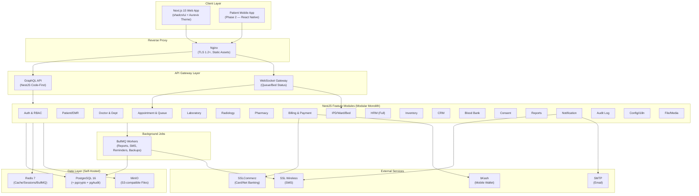
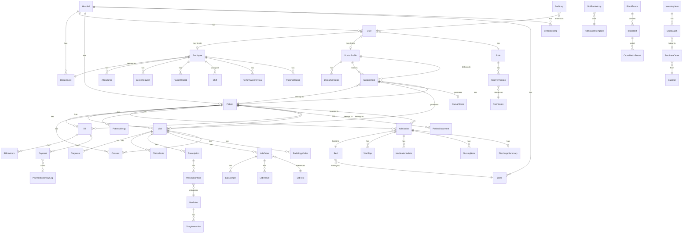
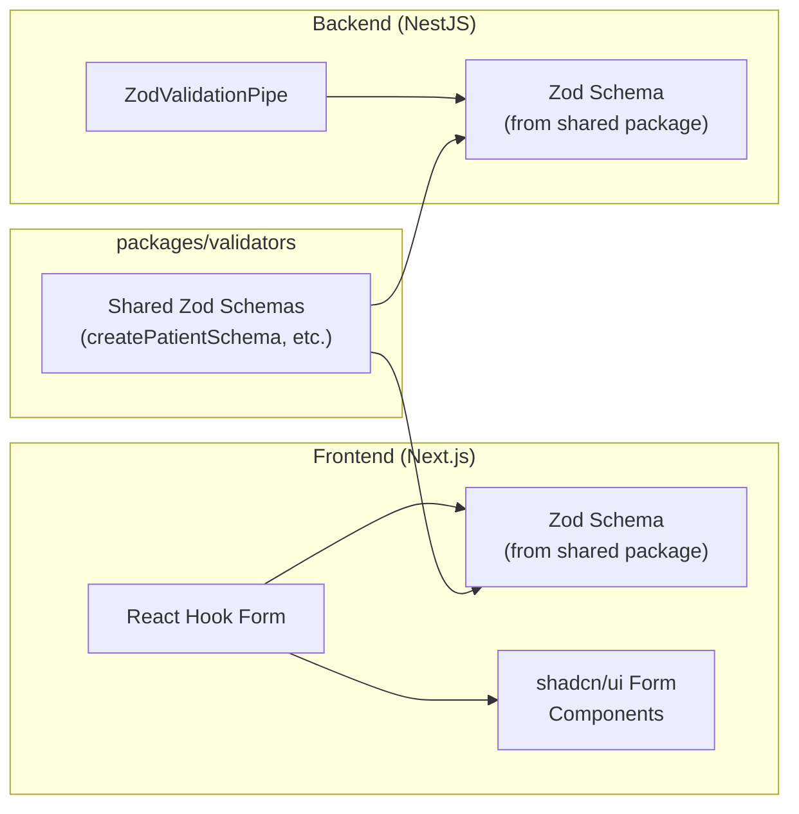

# Aurevix Hospital Management System — Final Execution Plan v2.0


> **Project Name:** Aurevix HMS **Version:** Final Plan v2.0 — All decisions locked. **Derived
> from:** SRS v2.0 — Every section, requirement ID, use case, NFR, and glossary term mapped.

---

## 1. Finalized Tech Stack

> [!NOTE] All technology decisions are **locked**. No further deliberation needed.

| Layer                 | Technology                                                                       | Version | Justification                                                            |
| :-------------------- | :------------------------------------------------------------------------------- | :------ | :----------------------------------------------------------------------- |
| **Frontend**          | Next.js (App Router)                                                             | 15.x    | SSR/SSG, Server Components, built-in i18n routing                        |
| **UI Library**        | shadcn/ui + Tailwind CSS                                                         | v4      | Accessible, composable, themeable — Aurevix brand                        |
| **Form Validation**   | React Hook Form + Zod + `@hookform/resolvers`                                    | Latest  | shadcn/ui-native form integration; dual-layer validation (client+server) |
| **State — Server**    | TanStack Query + `graphql-request`                                               | v5      | Auto-caching, background revalidation, optimistic updates for GraphQL    |
| **State — Client UI** | Zustand                                                                          | v5      | Lightweight modular stores (auth, sidebar, queue, theme, locale)         |
| **Backend**           | NestJS (TypeScript)                                                              | 11.x    | Modular DI, first-class GraphQL Code-First, Guards, Interceptors         |
| **API Layer**         | GraphQL (Code-First) + GraphQL Subscriptions                                     | Apollo  | Type-safe schema, flexible queries, real-time subscriptions              |
| **ORM**               | Prisma                                                                           | 6.x     | Type-safe DB access, migrations, seeding, introspection                  |
| **Database**          | PostgreSQL                                                                       | 16      | ACID, RLS, pgcrypto, pgAudit, JSONB, full-text search                    |
| **Cache / Queue**     | Redis                                                                            | 7.x     | Sessions, token queue caching, pub/sub for WebSocket, BullMQ jobs        |
| **Search**            | PostgreSQL Full-Text (MVP) → Meilisearch (Phase 2)                               | —       | Patient search, medicine lookup, ICD-10 codes                            |
| **File Storage**      | MinIO (self-hosted, S3-compatible)                                               | Latest  | Scans, reports, images, prescriptions (SRS §8.2)                         |
| **Real-time**         | WebSocket (Socket.io via NestJS Gateway)                                         | —       | Live queue/token display, bed-status board (SRS §8.4)                    |
| **SMS**               | **SSL Wireless** API (direct HTTP via Axios)                                     | —       | Bangladesh SMS delivery, Bangla/Unicode support                          |
| **Payments**          | **SSLCommerz** (card/internet banking) + **bKash** Tokenized Checkout + **Cash** | —       | BD payment ecosystem coverage                                            |
| **Email**             | Nodemailer (SMTP)                                                                | —       | Transactional emails (reports, password reset)                           |
| **Background Jobs**   | BullMQ (Redis-backed)                                                            | —       | Report generation, SMS batch, reminders, backups                         |
| **Testing**           | Jest + Supertest + Playwright + Storybook + k6                                   | —       | Unit, integration, E2E, visual, load testing                             |
| **CI/CD**             | GitHub Actions                                                                   | —       | Automated lint → test → build → deploy pipeline                          |
| **Containers**        | Docker + Docker Compose                                                          | —       | Self-hosted deployment (SRS §5.5)                                        |
| **Reverse Proxy**     | Nginx                                                                            | —       | TLS termination, load balancing, static asset serving                    |
| **Monitoring**        | Sentry + Prometheus + Grafana + Winston                                          | —       | Errors, metrics, dashboards, structured logging                          |
| **Monorepo**          | Turborepo + pnpm workspaces                                                      | —       | Shared packages, parallel builds, caching                                |

---

## 2. Aurevix Brand System

### 2.1 Brand Colors (Extracted from Logo)

| Token                | Hex       | Usage                                        |
| :------------------- | :-------- | :------------------------------------------- |
| `--brand-navy`       | `#0F1B3D` | Primary text, sidebar, headers               |
| `--brand-navy-light` | `#1E3056` | Hover states, active menu                    |
| `--brand-blue`       | `#3366CC` | Medical cross accent, links, primary buttons |
| `--brand-blue-light` | `#5B8DEF` | Focus rings, selected states                 |
| `--bg-primary`       | `#FFFFFF` | Light mode background                        |
| `--bg-secondary`     | `#F8FAFC` | Card backgrounds, table rows                 |
| `--bg-dark`          | `#0A1628` | Dark mode background                         |
| `--success`          | `#10B981` | Positive status, available beds              |
| `--warning`          | `#F59E0B` | Alerts, expiry warnings                      |
| `--danger`           | `#EF4444` | Critical values, errors, occupied beds       |
| `--info`             | `#3B82F6` | Information banners, tooltips                |

### 2.2 Typography

| Usage                  | Font                  | Weight        |
| :--------------------- | :-------------------- | :------------ |
| Headings (English)     | **Inter**             | 600, 700      |
| Body (English)         | **Inter**             | 400, 500      |
| Bengali (বাংলা)        | **Noto Sans Bengali** | 400, 500, 600 |
| Monospace (codes, IDs) | **JetBrains Mono**    | 400           |

### 2.3 Logo Usage

- Sidebar: Aurevix logo (compact icon variant for collapsed sidebar)
- Login page: Full logo centered
- Print headers: Logo + Hospital name
- Favicon: Medical cross icon from logo

---

## 3. Architecture Overview

### 3.1 High-Level Architecture (SRS §6)



### 3.2 Architecture Principles

1. **Modular Monolith** — Each NestJS module = bounded context. Can be extracted to microservice
   later (SRS §5.5)
2. **Feature-Based Organization** — Code organized by domain, not by layer
3. **Event-Driven Internal Communication** — `@nestjs/event-emitter` for cross-module triggers
   (e.g., consultation-complete → billing, lab-result-ready → notification)
4. **Patient-App-Ready APIs** — All appointment, EMR, billing, and notification GraphQL operations
   designed with public patient-facing access in mind (Phase 2 mobile app)
5. **Shared Kernel** — Common auth, audit, config, and file modules shared across all features

---

## 4. Project Structure (Monorepo)

```
aurevix-hms/
├── apps/
│   ├── web/                              # Next.js 15 Frontend
│   │   ├── app/                          # App Router
│   │   │   ├── [locale]/                 # i18n: /en/... and /bn/...
│   │   │   │   ├── (auth)/              # Login, Forgot Password, MFA
│   │   │   │   ├── (dashboard)/         # Role-specific dashboards
│   │   │   │   ├── patients/            # Patient management
│   │   │   │   ├── doctors/             # Doctor profiles & schedules
│   │   │   │   ├── appointments/        # Booking, queue, calendar
│   │   │   │   ├── emr/                 # Clinical records & consultation
│   │   │   │   ├── laboratory/          # Lab management
│   │   │   │   ├── radiology/           # Radiology
│   │   │   │   ├── pharmacy/            # Pharmacy & dispensing
│   │   │   │   ├── billing/             # Billing & payments
│   │   │   │   ├── ipd/                 # Admission, Ward, Bed
│   │   │   │   ├── hrm/                 # HR Management (full)
│   │   │   │   ├── inventory/           # Stock management
│   │   │   │   ├── crm/                 # Feedback & follow-up
│   │   │   │   ├── blood-bank/          # Blood bank
│   │   │   │   ├── reports/             # Analytics & reports
│   │   │   │   ├── settings/            # System configuration
│   │   │   │   ├── audit/               # Audit logs viewer
│   │   │   │   └── queue-display/       # TV-mode token display
│   │   │   └── api/                     # BFF proxy routes if needed
│   │   ├── components/
│   │   │   ├── ui/                      # shadcn/ui (Aurevix-themed)
│   │   │   ├── layouts/                 # AppShell, Sidebar, TopBar
│   │   │   ├── forms/                   # Reusable RHF+Zod form components
│   │   │   ├── tables/                  # DataTable with sort/filter/pagination
│   │   │   ├── charts/                  # Recharts dashboard widgets
│   │   │   └── print/                   # Print templates (Rx, Invoice, Lab, Discharge)
│   │   ├── lib/
│   │   │   ├── graphql/                 # Queries, mutations, fragments, codegen
│   │   │   ├── stores/                  # Zustand: useAuthStore, useQueueStore, etc.
│   │   │   ├── hooks/                   # Custom hooks (useDebounce, useKeyboard, etc.)
│   │   │   ├── i18n/                    # next-intl: en.json, bn.json
│   │   │   ├── schemas/                 # Zod schemas (shared with backend via package)
│   │   │   ├── utils/                   # Formatters, date helpers, currency
│   │   │   └── constants/              # Routes, roles, config keys
│   │   ├── styles/                      # globals.css, Aurevix theme tokens
│   │   ├── public/
│   │   │   └── assets/                  # Logo variants, favicon, OG image
│   │   └── __tests__/                   # Frontend tests (mirrors app/ structure)
│   │
│   └── api/                             # NestJS Backend
│       ├── src/
│       │   ├── main.ts
│       │   ├── app.module.ts
│       │   ├── common/                  # Shared kernel
│       │   │   ├── decorators/          # @Roles, @CurrentUser, @AuditAction, @Public
│       │   │   ├── guards/              # AuthGuard, RolesGuard, MFAGuard, ThrottlerGuard
│       │   │   ├── interceptors/        # AuditInterceptor, LoggingInterceptor, TimeoutInterceptor
│       │   │   ├── filters/             # GraphQLExceptionFilter
│       │   │   ├── pipes/               # ZodValidationPipe
│       │   │   ├── middleware/           # HospitalContext, RequestLogger
│       │   │   ├── interfaces/          # Shared types
│       │   │   ├── enums/               # Role, Status, PaymentMethod, etc.
│       │   │   ├── utils/               # Encryption, hashing, ID generators
│       │   │   └── scalars/             # Custom GraphQL scalars (DateTime, JSON, Upload)
│       │   │
│       │   ├── modules/
│       │   │   ├── auth/                # JWT/OAuth2, MFA, Sessions, Password Policy
│       │   │   ├── rbac/                # Roles, Permissions, Field/Record-level ACL
│       │   │   ├── config/              # Hospital config, Localization, System defaults
│       │   │   ├── hospital/            # Hospital/Branch entity management
│       │   │   ├── department/          # Department CRUD
│       │   │   ├── user/                # User management
│       │   │   ├── patient/             # Registration, Search, Portal-ready APIs
│       │   │   ├── doctor/              # Profiles, Schedules, Fees
│       │   │   ├── appointment/         # Booking, Queue, Token — Patient-App-Ready
│       │   │   ├── visit/               # Encounters, Diagnoses, Clinical Notes
│       │   │   ├── prescription/        # E-Prescriptions, Drug interactions
│       │   │   ├── laboratory/          # Orders, Samples, Results, Critical Values
│       │   │   ├── radiology/           # Requests, Reports, Approval
│       │   │   ├── pharmacy/            # Dispensing, Stock, Formulary
│       │   │   ├── billing/             # Invoices, Line Items, Refunds, Pricing
│       │   │   ├── payment/             # SSLCommerz, bKash, Cash — Gateway abstraction
│       │   │   ├── admission/           # IPD Admission, Ward, Bed, Transfer
│       │   │   ├── nursing/             # Vitals, Medication Admin, Nursing Notes
│       │   │   ├── discharge/           # Discharge Summary, Bed Release
│       │   │   ├── hrm/
│       │   │   │   ├── employee/        # Employee CRUD, Department assignment
│       │   │   │   ├── attendance/      # Check-in/out, Biometric sync, Reports
│       │   │   │   ├── shift/           # Shift templates, Rotation scheduling
│       │   │   │   ├── leave/           # Leave types, Balance, Request/Approve workflow
│       │   │   │   ├── payroll/         # Salary calc, Allowances, Deductions, Slip PDF
│       │   │   │   ├── recruitment/     # Job postings, Applications, Interview tracking
│       │   │   │   ├── training/        # Training programs, Attendance, Certificates
│       │   │   │   ├── performance/     # KPIs, Review cycles, Appraisals
│       │   │   │   ├── grievance/       # Complaints, Resolution tracking
│       │   │   │   └── hr-reports/      # Turnover, Attendance %, Payroll summaries
│       │   │   ├── inventory/           # Stock, Batches, PO, Suppliers, Expiry
│       │   │   ├── crm/                 # Feedback, Follow-up, Patient satisfaction
│       │   │   ├── blood-bank/          # Donors, Units, Cross-match, Stock
│       │   │   ├── consent/             # Templates, Digital signatures, Visit-linking
│       │   │   ├── notification/        # SSL Wireless SMS, Email, Templates, Logs
│       │   │   ├── report/              # Analytics, Export (PDF/Excel), Scheduled
│       │   │   ├── audit/               # Tamper-evident hash-chain audit log
│       │   │   └── file/                # MinIO upload/download, Image processing
│       │   │
│       │   ├── database/
│       │   │   ├── prisma/
│       │   │   │   ├── schema.prisma    # Full schema with all models
│       │   │   │   ├── migrations/      # Version-controlled migrations
│       │   │   │   └── seed/            # Comprehensive demo seeders
│       │   │   │       ├── index.ts              # Master seed orchestrator
│       │   │   │       ├── 01-hospitals.seed.ts
│       │   │   │       ├── 02-roles-permissions.seed.ts
│       │   │   │       ├── 03-users.seed.ts
│       │   │   │       ├── 04-departments.seed.ts
│       │   │   │       ├── 05-doctors.seed.ts
│       │   │   │       ├── 06-employees.seed.ts
│       │   │   │       ├── 07-patients.seed.ts
│       │   │   │       ├── 08-medicines.seed.ts
│       │   │   │       ├── 09-lab-tests.seed.ts
│       │   │   │       ├── 10-radiology-modalities.seed.ts
│       │   │   │       ├── 11-wards-beds.seed.ts
│       │   │   │       ├── 12-service-pricing.seed.ts
│       │   │   │       ├── 13-inventory.seed.ts
│       │   │   │       ├── 14-blood-bank.seed.ts
│       │   │   │       ├── 15-appointments.seed.ts
│       │   │   │       ├── 16-visits-prescriptions.seed.ts
│       │   │   │       ├── 17-lab-orders-results.seed.ts
│       │   │   │       ├── 18-admissions.seed.ts
│       │   │   │       ├── 19-bills-payments.seed.ts
│       │   │   │       ├── 20-leave-attendance.seed.ts
│       │   │   │       ├── 21-notification-templates.seed.ts
│       │   │   │       ├── 22-icd10-codes.seed.ts
│       │   │   │       ├── 23-system-config.seed.ts
│       │   │   │       └── 24-consent-templates.seed.ts
│       │   │   └── redis/               # Redis module config
│       │   │
│       │   └── websocket/               # Socket.io gateway (queue, bed board)
│       │
│       ├── test/                        # E2E tests
│       └── prisma/                      # Prisma CLI entry point
│
├── packages/                            # Shared packages (monorepo)
│   ├── shared-types/                    # TypeScript interfaces shared FE ↔ BE
│   ├── validators/                      # Zod schemas shared for dual-layer validation
│   └── graphql-codegen/                 # Auto-generated types from GraphQL schema
│
├── docs/                               # 📚 Project-level documentation
│   ├── srs-v2.md                        # Original SRS
│   ├── architecture.md                  # Architecture decisions
│   ├── api-reference/                   # Auto-generated GraphQL docs
│   ├── database-erd/                    # ER diagrams
│   ├── deployment-guide.md              # Self-hosted deployment steps
│   ├── developer-guide.md              # Onboarding, coding standards, PR process
│   └── modules/                         # Per-module docs (see §5)
│       ├── auth/
│       │   ├── FEATURE.md               # What it does, user stories
│       │   ├── DEV.md                   # Technical: schema, APIs, guards, testing
│       │   └── USER.md                  # End-user guide with screenshots
│       ├── patient/
│       │   ├── FEATURE.md
│       │   ├── DEV.md
│       │   └── USER.md
│       ├── ... (one folder per module)
│       └── hrm/
│           ├── FEATURE.md
│           ├── DEV.md
│           └── USER.md
│
├── docker/
│   ├── Dockerfile.web                   # Next.js production build
│   ├── Dockerfile.api                   # NestJS production build
│   ├── docker-compose.yml               # Full dev environment
│   ├── docker-compose.prod.yml          # Production stack
│   └── nginx/
│       ├── nginx.conf                   # Reverse proxy + TLS
│       └── ssl/                         # Self-signed or Let's Encrypt certs
│
├── .github/
│   └── workflows/
│       ├── ci.yml                       # Lint → Type-check → Test → Build
│       ├── cd-staging.yml               # Deploy to staging
│       └── cd-production.yml            # Deploy to production
│
├── scripts/
│   ├── setup.sh                         # One-command dev environment setup
│   ├── seed.sh                          # Run all database seeders
│   ├── backup.sh                        # Manual backup trigger
│   └── generate-docs.sh                 # Generate API docs
│
├── turbo.json
├── pnpm-workspace.yaml
├── package.json
├── .env.example                         # All env vars documented
└── README.md
```

---

## 5. Per-Module Documentation Standard

> [!IMPORTANT] **Every module** ships with 3 documents. No module is considered complete without all
> three.

### 5.1 Document Templates

#### FEATURE.md (Product/Feature Documentation)

```markdown
# [Module Name]

## Overview — What this module does and why

## User Stories — As a [role], I want to...

## Features List — Bullet list of all capabilities

## Workflows — Step-by-step user flows with diagrams

## Business Rules — Validation rules, constraints

## Screenshots / Wireframes — Visual reference

## Related Modules — Dependencies and integrations

## SRS Mapping — FR-IDs and NFR-IDs this module satisfies
```

#### DEV.md (Developer Documentation)

```markdown
# [Module Name] — Developer Guide

## Architecture — Module structure, key files

## Database Schema — Tables, relationships, indexes

## GraphQL API Reference — Queries, Mutations, Subscriptions with examples

## Zod Schemas — Validation schemas with field descriptions

## Guards & Decorators — Access control details

## Event Emitters — Events this module publishes/subscribes to

## Background Jobs — BullMQ jobs (if any)

## Testing — How to run tests, mock setup, fixtures

## Environment Variables — Required config

## Known Limitations / Future Work
```

#### USER.md (End-User Guide)

```markdown
# [Module Name] — User Guide

## Getting Started — First-time setup

## Step-by-Step Instructions — With annotated screenshots

## Keyboard Shortcuts — For high-volume desks

## Print Guides — How to print reports/receipts

## Troubleshooting / FAQ

## Bengali Translation Notes (if applicable)
```

### 5.2 Module Documentation Matrix

> [!NOTE] **FR-ID Traceability & Development Prefix Mappings:**
>
> 1. Prefix mappings like `FR-PAT.*` (Patient), `FR-APT.*` (Appointment), `FR-EMR.*` (EMR),
>    `FR-LAB.*` (Laboratory), and `FR-PHM.*` (Pharmacy) correspond to the itemized tables and
>    functional requirements defined in the SRS v2.0 document.
> 2. Prefix mappings like `FR-CFG.*` (System Config & i18n), `FR-DOC.*` (Doctor & Department),
>    `FR-BIL.*` (Billing & Payments), `FR-IPD.*` (IPD / Ward / Bed), `FR-HRM.*` (HRM), `FR-CRM.*`
>    (CRM), `FR-INV.*` (Inventory), `FR-BB.*` (Blood Bank), `FR-RAD.*` (Radiology), `FR-RPT.*`
>    (Reports & Analytics), and `FR-NOT.*` (Notifications) represent proposed developer-defined
>    prefix mappings created for code traceability and alignment. These modules are described in
>    prose in the SRS v2.0 but do not have itemized requirement ID tables in the SRS.

| Module                                        | FEATURE.md | DEV.md | USER.md | SRS Reference                   |
| :-------------------------------------------- | :--------- | :----- | :------ | :------------------------------ |
| Auth & RBAC                                   | ✅         | ✅     | ✅      | NFR-SEC.1, NFR-SEC.2, NFR-SEC.7 |
| System Config & i18n                          | ✅         | ✅     | ✅      | Proposed FR-CFG.*, §5.4         |
| Dashboard                                     | ✅         | ✅     | ✅      | §10.1                           |
| Patient Registration                          | ✅         | ✅     | ✅      | FR-PAT.*, UC-01                 |
| Doctor & Department                           | ✅         | ✅     | ✅      | Proposed FR-DOC.*               |
| Appointment & Queue                           | ✅         | ✅     | ✅      | FR-APT.*, UC-01, §8.4           |
| OPD Consultation & EMR                        | ✅         | ✅     | ✅      | FR-EMR.*, UC-02                 |
| Laboratory                                    | ✅         | ✅     | ✅      | FR-LAB.*, UC-02                 |
| Radiology                                     | ✅         | ✅     | ✅      | Proposed FR-RAD.*               |
| Pharmacy                                      | ✅         | ✅     | ✅      | FR-PHM.*, UC-02                 |
| Billing & Payments                            | ✅         | ✅     | ✅      | Proposed FR-BIL.*, UC-01/02/03  |
| IPD / Ward / Bed                              | ✅         | ✅     | ✅      | Proposed FR-IPD.*, UC-03        |
| HRM (Full)                                    | ✅         | ✅     | ✅      | Proposed FR-HRM.*               |
| CRM                                           | ✅         | ✅     | ✅      | Proposed FR-CRM.*               |
| Inventory                                     | ✅         | ✅     | ✅      | Proposed FR-INV.*               |
| Blood Bank                                    | ✅         | ✅     | ✅      | Proposed FR-BB.*                |
| Consent Capture                               | ✅         | ✅     | ✅      | NEW MVP                         |
| Reports & Analytics                           | ✅         | ✅     | ✅      | Proposed FR-RPT.*               |
| Notifications                                 | ✅         | ✅     | ✅      | Proposed FR-NOT.*, §8.3         |
| Audit Logs                                    | ✅         | ✅     | ✅      | NFR-SEC.5                       |
| **Total: 20 modules × 3 docs = 60 documents** |            |        |         |                                 |

---

## 6. Database Schema Design (SRS §7)

### 6.1 Entity Relationship Diagram



### 6.2 Key Schema Design Decisions

| Decision              | Approach                                                                                                                                                                                                 | SRS Mapping     |
| :-------------------- | :------------------------------------------------------------------------------------------------------------------------------------------------------------------------------------------------------- | :-------------- |
| Primary keys          | UUID v7 (time-sortable, distribution-ready)                                                                                                                                                              | §5.5            |
| Multi-branch          | `hospitalId` FK on all tenant-scoped entities + middleware scoping                                                                                                                                       | §5.5, §7        |
| Soft deletes          | `deletedAt` nullable timestamp on clinical encounters for clinical retention and audit trails                                                                                                            | §5.6            |
| GDPR Right to Erasure | Cryptographic anonymization engine for patient PII (overwriting Name, Phone, Email, NID to random hashes) for non-clinical data, preserving anonymous clinical encounters for statistical/billing audits | §5.6, NFR-SEC.* |
| Encrypted fields      | `pgcrypto` for NID, diagnosis; application-level for extra-sensitive                                                                                                                                     | NFR-SEC.4       |
| Audit trail           | Separate `audit_log` table, immutable append-only, hash chain                                                                                                                                            | NFR-SEC.5       |
| i18n data             | JSONB columns for multi-language labels (depts, services, templates)                                                                                                                                     | §5.4            |
| Temporal tracking     | `createdAt`, `updatedAt`, `createdBy`, `updatedBy` on all tables                                                                                                                                         | Standard        |
| Patient-app-ready     | `Appointment`, `Visit`, `Bill`, `LabResult` have patient-facing fields & status enums ready for patient portal/app queries                                                                               | Phase 2 prep    |

### 6.3 Prisma Schema Organization

The `schema.prisma` file uses logical grouping with comments:

- **Auth**: `User`, `Role`, `Permission`, `RolePermission`, `RefreshToken`, `MfaSecret`
- **Organization**: `Hospital`, `Branch`, `Department`
- **Patient**: `Patient`, `PatientAllergy`, `EmergencyContact`, `PatientDocument`
- **Doctor**: `DoctorProfile`, `DoctorSchedule`, `DoctorFee`
- **Scheduling**: `Appointment`, `QueueToken`, `AppointmentSlot`
- **Clinical**: `Visit`, `Diagnosis`, `ClinicalNote`, `VitalSign`
- **Prescription**: `Prescription`, `PrescriptionItem`, `Medicine`, `MedicineCategory`,
  `DrugInteraction`
- **Lab**: `LabTest`, `LabPanel`, `LabOrder`, `LabSample`, `LabResult`
- **Radiology**: `RadiologyModality`, `RadiologyOrder`, `RadiologyReport`
- **Pharmacy**: `PharmacyDispense`, `PharmacyDispenseItem`, `PharmacyShift`, `PharmacySale`,
  `PharmacySaleItem`, `PharmacyReturn`, `PharmacyReturnItem`, `PharmacySplitPayment`
- **Billing**: `Bill`, `BillLineItem`, `Payment`, `PaymentGatewayLog`, `ServicePrice`, `TaxConfig`
- **IPD**: `Admission`, `Ward`, `Bed`, `BedTransfer`, `NursingNote`, `MedicationAdmin`,
  `DischargeSummary`
- **HRM**: `Employee`, `EmployeeDocument`, `Attendance`, `Shift`, `ShiftTemplate`, `LeaveType`,
  `LeaveBalance`, `LeaveRequest`, `PayrollRecord`, `SalaryStructure`, `JobPosting`,
  `JobApplication`, `Interview`, `TrainingProgram`, `TrainingRecord`, `PerformanceReview`,
  `PerformanceKPI`, `Grievance`
- **Inventory**: `InventoryItem`, `StockBatch`, `StockTransaction`, `PurchaseOrder`,
  `PurchaseOrderItem`, `Supplier`
- **Blood Bank**: `BloodDonor`, `BloodUnit`, `BloodRequest`, `CrossMatchResult`
- **CRM**: `PatientFeedback`, `FollowUpSchedule`
- **Consent**: `ConsentTemplate`, `PatientConsent`
- **Notification**: `NotificationTemplate`, `NotificationLog`
- **Audit**: `AuditLog`
- **Config**: `SystemConfig`, `Localization`

### 6.4 GDPR Right to Erasure vs Clinical Retention Policy

To resolve the structural conflict between clinical record retention laws (which legally require
keeping medical encounters for a minimum of 5–10 years) and the GDPR "Right to Erasure" (Article
17):

1. **Clinical Records (Retention Exemption)**: Medical records (prescriptions, vitals, lab results,
   diagnoses) are protected by GDPR Article 17(3)(b) & (h) (processing necessary for compliance with
   a legal obligation or public health reasons). These records use **Soft Deletes** (`deletedAt`
   timestamp) to prevent accidental erasure, preserving the clinical audit trail.
2. **Personal Identifying Information (PII Anonymization)**: When a patient requests erasure (e.g.,
   via `anonymizePatientProfile(patientId)` mutation):
   - The patient's credentials, email, phone number, address, NID, emergency contact, and names are
     overwritten with cryptographically generated random hashes (e.g., `anonymized_hash_v7`).
   - The user account is deactivated, and active JWT tokens/sessions are invalidated in Redis.
   - The underlying clinical encounters remain in the database but are completely de-identified
     (linked to the anonymized patient ID), allowing the hospital to retain diagnostic statistics,
     billing records, and audit log events without holding any Personally Identifiable Information
     (PII).

---

## 7. Comprehensive Database Seeders

> [!IMPORTANT] **Every table gets seeded** with realistic Bangladeshi demo data. One command:
> `pnpm seed`

### 7.1 Seeder Execution Order & Data Volume

| #   | Seeder File                      | Records                           | Description                                                                                                                                                         |
| :-- | :------------------------------- | :-------------------------------- | :------------------------------------------------------------------------------------------------------------------------------------------------------------------ |
| 01  | `hospitals.seed.ts`              | 1 hospital + 2 branches           | "Aurevix General Hospital", Dhaka Main + Chittagong Branch                                                                                                          |
| 02  | `roles-permissions.seed.ts`      | 8 roles + ~120 permissions        | Super Admin, Admin, Doctor, Nurse, Lab Tech, Pharmacist, Receptionist, Accountant                                                                                   |
| 03  | `users.seed.ts`                  | 25 users                          | Login-ready users across all roles (password: `Demo@123`)                                                                                                           |
| 04  | `departments.seed.ts`            | 15 departments                    | Cardiology, Orthopedics, Pediatrics, Gynecology, General Medicine, Surgery, ENT, Ophthalmology, Dermatology, Neurology, Urology, Psychiatry, Dental, Emergency, ICU |
| 05  | `doctors.seed.ts`                | 12 doctors                        | With profiles, schedules, fees, department assignments                                                                                                              |
| 06  | `employees.seed.ts`              | 30 employees                      | Nurses, technicians, admin staff, cleaners with salary structures                                                                                                   |
| 07  | `patients.seed.ts`               | 50 patients                       | Realistic BD names, phone numbers, NID, blood groups, allergies                                                                                                     |
| 08  | `medicines.seed.ts`              | 200 medicines                     | BD formulary: generics + brands, categories, dosage forms, prices, drug interactions                                                                                |
| 09  | `lab-tests.seed.ts`              | 80 tests                          | CBC, LFT, RFT, Lipid Profile, HbA1c, etc. with reference ranges                                                                                                     |
| 10  | `radiology-modalities.seed.ts`   | 20 studies                        | X-Ray, CT, MRI, Ultrasound, ECG, Echo with pricing                                                                                                                  |
| 11  | `wards-beds.seed.ts`             | 4 wards + 40 beds                 | General (20), Semi-Private (10), Private (6), ICU (4)                                                                                                               |
| 12  | `service-pricing.seed.ts`        | 50 service prices                 | Consultation fees, procedures, room charges                                                                                                                         |
| 13  | `inventory.seed.ts`              | 100 items + 200 batches           | Medicines, consumables, equipment with stock levels + expiry dates                                                                                                  |
| 14  | `blood-bank.seed.ts`             | 20 donors + 30 units              | All blood groups represented                                                                                                                                        |
| 15  | `appointments.seed.ts`           | 30 appointments                   | Past (completed), today, and future appointments                                                                                                                    |
| 16  | `visits-prescriptions.seed.ts`   | 20 visits + 20 prescriptions      | With diagnoses (ICD-10), clinical notes, prescription items                                                                                                         |
| 17  | `lab-orders-results.seed.ts`     | 15 lab orders + results           | Various statuses: pending, collected, resulted, approved                                                                                                            |
| 18  | `admissions.seed.ts`             | 5 admissions                      | Active + discharged with vitals, nursing notes                                                                                                                      |
| 19  | `bills-payments.seed.ts`         | 25 bills + 30 payments            | Paid, partial, due — Cash, SSLCommerz, bKash examples                                                                                                               |
| 20  | `leave-attendance.seed.ts`       | 60 attendance + 10 leave requests | Last 30 days of attendance, leave balances                                                                                                                          |
| 21  | `notification-templates.seed.ts` | 15 templates                      | Appointment confirmation, lab result, bill due, follow-up (EN + BN)                                                                                                 |
| 22  | `icd10-codes.seed.ts`            | 500 common codes                  | Most frequent diagnoses in Bangladesh                                                                                                                               |
| 23  | `system-config.seed.ts`          | 30 config entries                 | Hospital name, timezone, currency (BDT), UHID format, fiscal year                                                                                                   |
| 24  | `consent-templates.seed.ts`      | 10 templates                      | Surgery, procedure, anesthesia, blood transfusion consent forms                                                                                                     |

### 7.2 Seeder Features

- **Idempotent** — Safe to run multiple times (upsert logic)
- **Deterministic** — Same data every run for consistent demos
- **Realistic** — Bangladeshi names, addresses, phone formats (+880), NID formats
- **Relational** — All FK relationships properly linked
- **Time-aware** — Appointments/visits use relative dates (today ± N days)
- **Login-ready demo accounts:**

| Role           | Email                      | Password   |
| :------------- | :------------------------- | :--------- |
| Super Admin    | `admin@aurevix.com`        | `Demo@123` |
| Doctor         | `dr.rahim@aurevix.com`     | `Demo@123` |
| Receptionist   | `reception@aurevix.com`    | `Demo@123` |
| Nurse          | `nurse.fatima@aurevix.com` | `Demo@123` |
| Lab Technician | `lab@aurevix.com`          | `Demo@123` |
| Pharmacist     | `pharmacy@aurevix.com`     | `Demo@123` |
| Accountant     | `accounts@aurevix.com`     | `Demo@123` |
| HR Manager     | `hr@aurevix.com`           | `Demo@123` |

---

## 8. Form Validation Strategy

### 8.1 Dual-Layer Validation Architecture



### 8.2 Shared Validation Package (`packages/validators`)

```typescript
// packages/validators/src/patient.schema.ts
import { z } from 'zod';

export const createPatientSchema = z.object({
  firstName: z.string().min(2).max(100),
  lastName: z.string().min(2).max(100),
  phone: z.string().regex(/^\+880\d{10}$/, 'Invalid BD phone number'),
  email: z.string().email().optional(),
  dateOfBirth: z.coerce.date(),
  gender: z.enum(['MALE', 'FEMALE', 'OTHER']),
  bloodGroup: z.enum(['A+', 'A-', 'B+', 'B-', 'AB+', 'AB-', 'O+', 'O-']).optional(),
  nid: z
    .string()
    .regex(/^\d{10,17}$/, 'Invalid NID')
    .optional(),
  address: z.string().max(500).optional(),
  emergencyContactName: z.string().optional(),
  emergencyContactPhone: z
    .string()
    .regex(/^\+880\d{10}$/)
    .optional(),
});

export type CreatePatientInput = z.infer<typeof createPatientSchema>;
```

### 8.3 Frontend Usage (shadcn/ui + RHF + Zod)

```typescript
// apps/web/components/forms/PatientForm.tsx
'use client';
import { useForm } from 'react-hook-form';
import { zodResolver } from '@hookform/resolvers/zod';
import { createPatientSchema, CreatePatientInput } from '@aurevix/validators';
import {
  Form,
  FormField,
  FormItem,
  FormLabel,
  FormControl,
  FormMessage,
} from '@/components/ui/form';

export function PatientForm() {
  const form = useForm<CreatePatientInput>({
    resolver: zodResolver(createPatientSchema),
    defaultValues: { firstName: '', lastName: '', phone: '+880', gender: 'MALE' },
  });
  // ... render shadcn form fields
}
```

### 8.4 Backend Usage (NestJS + Zod)

```typescript
// apps/api/src/common/pipes/zod-validation.pipe.ts
@Injectable()
export class ZodValidationPipe implements PipeTransform {
  constructor(private schema: ZodSchema) {}
  transform(value: unknown) {
    const result = this.schema.safeParse(value);
    if (!result.success) throw new BadRequestException(result.error.flatten());
    return result.data;
  }
}
```

### 8.5 Form Components Inventory

Every form in the system uses the same pattern: **shadcn/ui `<Form>` → React Hook Form → Zod schema
from shared package**. Key reusable form components:

| Component          | Usage                                          |
| :----------------- | :--------------------------------------------- |
| `PhoneInput`       | BD phone format with +880 prefix, validation   |
| `DatePicker`       | Calendar with Bangla date support              |
| `NIDInput`         | NID format validation + masking                |
| `SearchableSelect` | Doctor, department, medicine autocomplete      |
| `ICD10Picker`      | Diagnosis code search + select                 |
| `MedicineSelector` | Drug search with interaction warnings          |
| `PriceInput`       | BDT currency formatting                        |
| `FileUpload`       | Drag-drop with preview (images, PDFs)          |
| `SignaturePad`     | Canvas-based digital signature (consent forms) |
| `TimeSlotPicker`   | Appointment slot selection grid                |
| `BedSelector`      | Visual ward/bed selection                      |

---

## 9. Sprint-by-Sprint Execution Plan — Phase 1 (MVP)

> Every sprint maps to SRS §10.1. Each includes scope, backend GraphQL operations, frontend pages,
> form schemas, documentation deliverables, seeder data, and test requirements.

---

### Sprint 0: Foundation & Infrastructure (Weeks 1–3)

#### Deliverables

- [ ] Turborepo monorepo initialization with `apps/web`, `apps/api`, `packages/*`
- [ ] Next.js 15 scaffold with App Router + `next-intl` (EN/BN)
- [ ] NestJS scaffold with GraphQL Code-First + Prisma
- [ ] shadcn/ui installation + Aurevix theme tokens (§2 brand colors)
- [ ] Zustand store architecture (auth, sidebar, theme, locale, notifications)
- [ ] TanStack Query + `graphql-request` client configured
- [ ] React Hook Form + Zod + `@hookform/resolvers` setup
- [ ] `packages/validators` — shared Zod schema package
- [ ] `packages/shared-types` — shared TypeScript types
- [ ] GraphQL Codegen pipeline (schema → TypeScript types)
- [ ] Docker Compose: PostgreSQL 16, Redis 7, MinIO
- [ ] Nginx reverse proxy configuration with self-signed TLS
- [ ] ESLint + Prettier + Husky + lint-staged
- [ ] Jest config (both apps) + Playwright config
- [ ] Storybook for component library
- [ ] CI pipeline: GitHub Actions (lint → type-check → test → build)
- [ ] Base layout shell: Sidebar (Aurevix logo), TopBar (user, branch, language selector),
      MainContent area
- [ ] Common backend: GraphQL error handling, DataLoader factory, pagination utilities, base CRUD
      service, encryption utils (argon2, pgcrypto), logging interceptor (never log passwords), file
      upload module (MinIO)
- [ ] Print stylesheet foundation (`@media print`)
- [ ] Keyboard navigation system setup
- [ ] WCAG 2.1 AA baseline (axe-core integration)

**Tests:** Unit tests for all utilities. Integration test for DB + Redis connection. Storybook
stories for all base UI components.

**Docs:** `docs/developer-guide.md`, `docs/architecture.md`, `docs/deployment-guide.md`

---

### Sprint 1: Auth & RBAC (Weeks 3–5) — NFR-SEC.1, NFR-SEC.2, NFR-SEC.3, NFR-SEC.7

#### Backend — GraphQL Operations

| Operation                                  | Type     | Description                              |
| :----------------------------------------- | :------- | :--------------------------------------- |
| `login(email, password)`                   | Mutation | JWT access (15min) + refresh (7d) tokens |
| `refreshToken(token)`                      | Mutation | Issue new access token                   |
| `logout`                                   | Mutation | Invalidate refresh token                 |
| `forgotPassword(email)`                    | Mutation | Send reset email                         |
| `resetPassword(token, newPassword)`        | Mutation | Reset with token                         |
| `enableMfa / verifyMfa / disableMfa`       | Mutation | TOTP MFA                                 |
| `me`                                       | Query    | Current user + permissions               |
| `users(filters, pagination)`               | Query    | User list (admin)                        |
| `createUser / updateUser / deactivateUser` | Mutation | User CRUD                                |
| `roles`                                    | Query    | All roles                                |
| `createRole / updateRole / deleteRole`     | Mutation | Role CRUD                                |
| `permissions`                              | Query    | All permissions                          |
| `assignPermissionsToRole`                  | Mutation | Permission assignment                    |

#### Implementation Details

- JWT with RS256 asymmetric keys; access token 15min, refresh token 7-day HTTP-only cookie
- AuthGuard extracts JWT from GraphQL context
- RolesGuard with `@Roles()` decorator
- Field-level permission middleware (e.g., NID visible only to authorized roles)
- Record-level access (e.g., doctor sees only their patients)
- MFA via TOTP (`otplib`) for Admin, Doctor, Pharmacist roles
- Session timeout: frontend idle detector + server token expiry
- Re-auth modal for high-sensitivity screens (viewing NID, modifying billing)
- Password policy: min 8 chars, upper+lower+digit+special
- Rate limiting on auth endpoints (NestJS Throttler)
- Account lockout after 5 failed attempts (15-minute cooldown)
- Argon2id password hashing with unique salts — NFR-SEC.3
- Request body sanitization: never log password fields

#### Frontend Pages

| Page                      | Route                         |
| :------------------------ | :---------------------------- |
| Login                     | `/[locale]/login`             |
| Forgot Password           | `/[locale]/forgot-password`   |
| Reset Password            | `/[locale]/reset-password`    |
| MFA Setup                 | `/[locale]/settings/security` |
| User Management           | `/[locale]/settings/users`    |
| Role & Permission Manager | `/[locale]/settings/roles`    |

#### Zod Schemas: `loginSchema`, `createUserSchema`, `resetPasswordSchema`, `roleSchema`

#### Seeders: `02-roles-permissions.seed.ts`, `03-users.seed.ts`

#### Tests

- Unit: JWT gen/validate, argon2 hash/verify, MFA TOTP, role guard logic, rate limiter
- Integration: login flow, token refresh, permission checks, account lockout
- E2E (Playwright): login → MFA → dashboard; unauthorized redirect; role-restricted pages

#### Docs: `docs/modules/auth/FEATURE.md`, `DEV.md`, `USER.md`

---

### Sprint 2: System Config & Localization (Weeks 5–6) — FR-CFG.*, §5.4

#### Backend — GraphQL Operations

| Operation                                           | Type           | Description                  |
| :-------------------------------------------------- | :------------- | :--------------------------- |
| `systemConfig`                                      | Query          | All config key-value pairs   |
| `updateConfig(key, value)`                          | Mutation       | Update system setting        |
| `hospitals / updateHospital`                        | Query/Mutation | Hospital info, logo upload   |
| `branches / createBranch / updateBranch`            | CRUD           | Branch management            |
| `departments / createDepartment / updateDepartment` | CRUD           | Department CRUD              |
| `updateUserLocale(locale)`                          | Mutation       | Per-user language preference |

#### Implementation

- Hospital: name, address, phone, email, logo (MinIO), timezone, currency (BDT)
- Branch management (multi-branch ready)
- Department CRUD with bilingual names (JSONB)
- Configurable system defaults: UHID format, token format, fiscal year, consultation fee
- `next-intl` message files: `en.json`, `bn.json` — all UI strings externalized

#### Frontend Pages

| Page                  | Route                            |
| :-------------------- | :------------------------------- |
| Hospital Settings     | `/[locale]/settings/hospital`    |
| Branch Management     | `/[locale]/settings/branches`    |
| Department Management | `/[locale]/settings/departments` |
| System Defaults       | `/[locale]/settings/system`      |

- Language switcher (EN ↔ বাংলা) in TopBar — instant toggle

#### Seeders: `01-hospitals.seed.ts`, `04-departments.seed.ts`, `23-system-config.seed.ts`

#### Tests: Unit: config validation. Integration: config CRUD + persistence. E2E: language switching.

#### Docs: `docs/modules/config/FEATURE.md`, `DEV.md`, `USER.md`

---

### Sprint 3: Dashboard (Weeks 6–7) — §10.1

#### Backend — GraphQL Operations

| Operation                         | Type  | Description          |
| :-------------------------------- | :---- | :------------------- |
| `dashboardStats(role)`            | Query | Role-specific KPIs   |
| `recentActivities(limit)`         | Query | Activity feed        |
| `todayAppointmentsSummary`        | Query | Counts by status     |
| `bedOccupancySummary`             | Query | Ward-wise occupancy  |
| `revenueToday / revenueThisMonth` | Query | Billing summaries    |
| `pendingLabOrders`                | Query | Count for lab tech   |
| `pendingPrescriptions`            | Query | Count for pharmacist |
| `lowStockAlerts`                  | Query | Inventory warnings   |
| `upcomingFollowUps`               | Query | CRM reminders        |

#### Frontend — Role-Specific Dashboards

| Role             | Widgets                                                                                |
| :--------------- | :------------------------------------------------------------------------------------- |
| **Admin**        | Revenue chart, patient count trend, department load, staff attendance %, system health |
| **Doctor**       | Today's queue, pending labs, recent patients, appointment calendar mini                |
| **Receptionist** | Walk-in queue, today's appointments, pending registrations                             |
| **Nurse**        | Ward overview, pending vitals, medication administration schedule                      |
| **Lab Tech**     | Pending samples, results to approve, TAT metrics                                       |
| **Pharmacist**   | Pending prescriptions, low stock alerts, today's dispensed                             |
| **Accountant**   | Revenue today, pending bills, payment method breakdown                                 |
| **HR Manager**   | Today's attendance, pending leave requests, upcoming payroll                           |

- Charts: Recharts (line, bar, pie, area)
- Real-time updates via WebSocket
- Performance target: < 2 seconds load (NFR-PRF.2)

#### Tests: Unit: aggregation logic per role. Integration: stats accuracy. E2E: dashboard renders per role.

#### Docs: `docs/modules/dashboard/FEATURE.md`, `DEV.md`, `USER.md`

---

### Sprint 4: Patient Registration & Management (Weeks 7–9) — FR-PAT.*, UC-01

#### Backend — GraphQL Operations

| Operation                               | Type     | Description                                          |
| :-------------------------------------- | :------- | :--------------------------------------------------- |
| `patients(search, filters, pagination)` | Query    | Search by name/phone/NID/UHID                        |
| `patient(id)`                           | Query    | Full profile + history                               |
| `createPatient(input)`                  | Mutation | New registration (Zod validated)                     |
| `updatePatient(id, input)`              | Mutation | Edit demographics                                    |
| `mergePatients(sourceId, targetId)`     | Mutation | Deduplicate                                          |
| `patientTimeline(id)`                   | Query    | Chronological visit/billing/lab history              |
| `patientDocuments(id)`                  | Query    | Uploaded documents                                   |
| `uploadPatientDocument`                 | Mutation | Upload to MinIO                                      |
| `patientAppointments(id)`               | Query    | 🔮 Patient-app-ready: all appointments for a patient |
| `patientBills(id)`                      | Query    | 🔮 Patient-app-ready: billing history                |
| `patientLabResults(id)`                 | Query    | 🔮 Patient-app-ready: lab result history             |

> 🔮 = Designed for future Patient Mobile App (Phase 2). APIs are public-facing-ready with patient
> auth scope.

#### Implementation

- Auto-generate UHID (configurable format per branch, e.g., `AV-DHK-000001`)
- NID encrypted at rest via pgcrypto (NFR-SEC.4)
- Patient photo upload (MinIO)
- Allergy recording (critical for prescription safety — UC-02 Step 4)
- Emergency contact management
- Fuzzy patient search (PostgreSQL trigram + full-text)
- Duplicate detection on create: phone + name + DOB matching
- Patient document uploads (previous medical records, images)

#### Frontend Pages

| Page             | Route                              |
| :--------------- | :--------------------------------- |
| Patient List     | `/[locale]/patients`               |
| New Patient      | `/[locale]/patients/new`           |
| Patient Profile  | `/[locale]/patients/[id]`          |
| Patient Timeline | `/[locale]/patients/[id]/timeline` |

- Keyboard-optimized registration form (Tab → Tab → Enter) — SRS §5.4
- Barcode/QR scan to look up existing patient — SRS §8.2
- Print patient card / wristband label

#### Zod Schemas: `createPatientSchema`, `updatePatientSchema`, `patientSearchSchema`

#### Seeders: `07-patients.seed.ts` (50 patients with BD names, allergies, contacts)

#### Tests: Unit: UHID gen, duplicate detection, encryption. Integration: full CRUD + search. E2E: UC-01 Steps 1–2.

#### Docs: `docs/modules/patient/FEATURE.md`, `DEV.md`, `USER.md`

---

### Sprint 5: Doctor & Department Management (Weeks 9–10) — FR-DOC.*

#### Backend — GraphQL Operations

| Operation                       | Type     | Description                                        |
| :------------------------------ | :------- | :------------------------------------------------- |
| `doctors(filters, pagination)`  | Query    | List by department, specialty                      |
| `doctor(id)`                    | Query    | Full profile + schedule                            |
| `createDoctor / updateDoctor`   | Mutation | Profile CRUD                                       |
| `doctorSchedule(id, dateRange)` | Query    | Weekly available slots                             |
| `updateSchedule(id, slots)`     | Mutation | Set recurring time slots                           |
| `doctorFees(id)`                | Query    | 🔮 Patient-app-ready: fees per doctor              |
| `doctorAvailability(id, date)`  | Query    | 🔮 Patient-app-ready: real-time availability check |

#### Implementation

- Doctor ↔ User ↔ Employee 3-way linking
- Multi-department assignment with primary/secondary
- Consultation fee per doctor per department
- Weekly schedule templates (recurring slots: day + startTime + endTime + maxPatients)
- Holiday/leave blocking (auto-sync with HRM leave module)
- Specialization, qualifications, BMDC registration number
- Profile photo upload

#### Frontend Pages

| Page             | Route                             |
| :--------------- | :-------------------------------- |
| Doctor Directory | `/[locale]/doctors`               |
| Doctor Profile   | `/[locale]/doctors/[id]`          |
| Schedule Editor  | `/[locale]/doctors/[id]/schedule` |

- Drag-and-drop weekly schedule planner
- Department filter with count badges

#### Zod Schemas: `createDoctorSchema`, `scheduleSlotSchema`

#### Seeders: `05-doctors.seed.ts` (12 doctors with schedules, fees, departments)

#### Tests: Unit: slot generation, conflict check. Integration: doctor-department link. E2E: create + schedule.

#### Docs: `docs/modules/doctor/FEATURE.md`, `DEV.md`, `USER.md`

---

### Sprint 6: Appointment & Queue Management (Weeks 10–12) — FR-APT.*, UC-01

> **Patient-App-Ready Design**: All booking, availability, and queue APIs are designed to be
> directly consumed by the Phase 2 Patient Mobile App without modifications.

#### Backend — GraphQL Operations

| Operation                              | Type         | Description                                       |
| :------------------------------------- | :----------- | :------------------------------------------------ |
| `availableSlots(doctorId, date)`       | Query        | 🔮 Open time slots (patient-app-ready)            |
| `availableDoctors(departmentId, date)` | Query        | 🔮 Doctors with slots (patient-app-ready)         |
| `createAppointment(input)`             | Mutation     | 🔮 Book slot → generate token (patient-app-ready) |
| `myAppointments(status, pagination)`   | Query        | 🔮 Patient's own appointments (patient-app-ready) |
| `cancelAppointment(id, reason)`        | Mutation     | 🔮 Cancel with reason (patient-app-ready)         |
| `rescheduleAppointment(id, newSlotId)` | Mutation     | 🔮 Move to new slot (patient-app-ready)           |
| `appointmentDetails(id)`               | Query        | 🔮 Full appointment info (patient-app-ready)      |
| `todayQueue(doctorId)`                 | Query        | Ordered queue for doctor                          |
| `checkInPatient(appointmentId)`        | Mutation     | Mark arrived at reception                         |
| `callNextPatient(doctorId)`            | Mutation     | Advance queue                                     |
| `skipPatient(appointmentId, reason)`   | Mutation     | Skip no-show                                      |
| `queueStatus(doctorId)`                | Subscription | 🔮 Real-time queue position (patient-app-ready)   |
| `queueDisplay(departmentId)`           | Subscription | TV display: current/next tokens                   |

#### Patient-App-Ready Design Decisions

- **Appointment Status Enum**:
  `BOOKED → CONFIRMED → CHECKED_IN → IN_PROGRESS → COMPLETED → CANCELLED → NO_SHOW`
- **Patient-scoped queries**: `myAppointments` filtered by authenticated patient's ID
- **Push notification hooks**: Events emitted for `APPOINTMENT_REMINDER`, `QUEUE_POSITION_UPDATE`,
  `DOCTOR_RUNNING_LATE`
- **Estimated wait time calculation**: Based on average consultation duration × queue position
- **Online booking rules**: Configurable max-advance-booking days, cancellation window, reschedule
  limit

#### Implementation

- Token generation: sequential per doctor per day (e.g., `T-001`, `T-002`)
- SMS confirmation on booking via SSL Wireless — UC-01 Step 4
- Conflict detection (no double booking same doctor + same slot)
- Walk-in vs. scheduled appointment types
- WebSocket subscription for live queue display
- Offline token printing via localStorage fallback (SRS §5.3 graceful degradation)
- Redis-backed queue for real-time performance
- Configurable appointment duration per doctor/department

#### Frontend Pages

| Page                 | Route                             |
| :------------------- | :-------------------------------- |
| Book Appointment     | `/[locale]/appointments/new`      |
| Appointment List     | `/[locale]/appointments`          |
| Queue Management     | `/[locale]/appointments/queue`    |
| Queue Display (TV)   | `/[locale]/queue-display`         |
| Appointment Calendar | `/[locale]/appointments/calendar` |

- Real-time queue display (WebSocket)
- Token print template (thermal printer format)
- Calendar view (weekly/monthly) with drag-reschedule
- Offline queue mode with Service Worker + localStorage

#### Zod Schemas: `createAppointmentSchema`, `rescheduleSchema`, `cancelSchema`

#### Seeders: `15-appointments.seed.ts` (30 appointments: past, today, future)

#### Tests: Unit: slot availability, token gen, conflict, wait time calc. Integration: booking → SMS → token. E2E: UC-01 complete flow.

#### Docs: `docs/modules/appointment/FEATURE.md`, `DEV.md`, `USER.md`

---

### Sprint 7: OPD Consultation & EMR (Weeks 12–15) — FR-EMR.*, UC-02

#### Backend — GraphQL Operations

| Operation                                       | Type     | Description                                       |
| :---------------------------------------------- | :------- | :------------------------------------------------ |
| `startConsultation(appointmentId)`              | Mutation | Create visit, link appointment                    |
| `patientEmr(patientId)`                         | Query    | Full EMR with history                             |
| `addVitals(visitId, input)`                     | Mutation | BP, temp, weight, SpO2, pulse                     |
| `addDiagnosis(visitId, input)`                  | Mutation | ICD-10 coded + free text                          |
| `addClinicalNote(visitId, input)`               | Mutation | SOAP/free-text notes                              |
| `createPrescription(visitId, items)`            | Mutation | E-prescription                                    |
| `checkDrugInteractions(patientId, medicineIds)` | Query    | Against allergies + current meds                  |
| `searchICD10(query)`                            | Query    | ICD-10 code lookup                                |
| `searchMedicine(query)`                         | Query    | Medicine autocomplete                             |
| `orderLabTests(visitId, testIds)`               | Mutation | Create lab orders                                 |
| `orderRadiology(visitId, modalityId, notes)`    | Mutation | Create radiology order                            |
| `completeConsultation(visitId)`                 | Mutation | Trigger: billing + lab routing + pharmacy routing |
| `visitHistory(patientId)`                       | Query    | 🔮 Patient-app-ready: past visits                 |
| `prescriptionHistory(patientId)`                | Query    | 🔮 Patient-app-ready: past prescriptions          |

#### Implementation

- ICD-10 diagnosis code searchable database (seeded with 500 common codes)
- Clinical note templates customizable per department
- Drug interaction checking: patient allergies × new prescription items
- Prescription with: medicine name, generic name, dose, frequency, duration, instructions
- Visit auto-links to appointment/queue token
- **Event-driven triggers on `completeConsultation`:**
  - `consultation.completed` → BillingModule creates bill line items
  - `lab.ordered` → LabModule adds to tech worklist
  - `prescription.created` → PharmacyModule adds to pharmacist queue
  - `notification.send` → SMS to patient about prescription ready

#### Frontend Pages

| Page                   | Route                                |
| :--------------------- | :----------------------------------- |
| Doctor Queue           | `/[locale]/emr/queue`                |
| Consultation Workspace | `/[locale]/emr/visit/[id]`           |
| Patient History        | `/[locale]/emr/patient/[id]/history` |

- Split-pane EMR workspace: patient history (left) + current visit (right)
- Tabbed sections: Vitals, Diagnosis, Notes, Prescription, Lab Orders, Radiology
- ICD-10 searchable combobox with autocomplete
- Drug search with real-time interaction warnings (red banner)
- Allergy warning banner (prominent, non-dismissible during prescription)
- Print prescription (hospital letterhead format)
- Keyboard shortcuts: `Ctrl+D` diagnosis, `Ctrl+P` prescription, `Ctrl+L` lab order

#### Zod Schemas: `vitalsSchema`, `diagnosisSchema`, `clinicalNoteSchema`, `prescriptionSchema`, `prescriptionItemSchema`

#### Seeders: `16-visits-prescriptions.seed.ts`, `22-icd10-codes.seed.ts`

#### Tests: Unit: drug interaction engine, ICD-10 search. Integration: visit → billing trigger. E2E: UC-02 complete.

#### Docs: `docs/modules/emr/FEATURE.md`, `DEV.md`, `USER.md`

---

### Sprint 8: Laboratory Management (Weeks 15–17) — FR-LAB.*

#### Backend — GraphQL Operations

| Operation                          | Type         | Description                              |
| :--------------------------------- | :----------- | :--------------------------------------- |
| `labWorklist(filters, status)`     | Query        | Pending/in-progress/completed            |
| `labOrder(id)`                     | Query        | Full order with samples + results        |
| `collectSample(orderId, input)`    | Mutation     | Mark collected, generate barcode label   |
| `enterLabResult(orderId, results)` | Mutation     | Tech enters result values                |
| `approveLabResult(orderId)`        | Mutation     | Pathologist approves                     |
| `rejectLabResult(orderId, reason)` | Mutation     | Send back for re-run                     |
| `flagCriticalValue(orderId)`       | Mutation     | Trigger immediate notification           |
| `labTestCatalog(search, category)` | Query        | Available tests + reference ranges       |
| `labTestPanels`                    | Query        | Grouped test panels (LFT, RFT, etc.)     |
| `patientLabHistory(patientId)`     | Query        | 🔮 Patient-app-ready                     |
| `labResultNotification`            | Subscription | 🔮 Patient-app-ready: result ready alert |

#### Implementation

- Lab test catalog: 80 tests with reference ranges (age/gender-specific)
- Test panels (CBC, LFT, RFT, Lipid Panel, Thyroid, etc.)
- Sample barcode generation (Code128) — SRS §8.2
- Result entry with auto-flagging: Normal / Abnormal / Critical
- **Critical value protocol**: immediate SMS + in-app alert to ordering doctor (SRS Glossary)
- Two-tier approval: Technician enters → Pathologist approves
- Lab report PDF generation with hospital letterhead
- TAT (Turnaround Time) tracking
- Results visible in patient EMR + patient portal (Phase 2)

#### Frontend Pages

| Page                 | Route                               |
| :------------------- | :---------------------------------- |
| Lab Worklist         | `/[locale]/laboratory`              |
| Sample Collection    | `/[locale]/laboratory/collect/[id]` |
| Result Entry         | `/[locale]/laboratory/results/[id]` |
| Lab Reports          | `/[locale]/laboratory/reports`      |
| Test Catalog (Admin) | `/[locale]/laboratory/catalog`      |

- Barcode scanner: keyboard-wedge input capture
- Critical value: red banner + audio alert
- Print: lab report, barcode labels

#### Zod Schemas: `labResultSchema`, `sampleCollectionSchema`

#### Seeders: `09-lab-tests.seed.ts`, `17-lab-orders-results.seed.ts`

#### Tests: Unit: reference range logic, critical detection. Integration: order → collect → result → approve. E2E: full lab cycle.

#### Docs: `docs/modules/laboratory/FEATURE.md`, `DEV.md`, `USER.md`

---

### Sprint 9: Radiology (Weeks 17–18) — FR-RAD.*

#### Backend

| Operation                               | Type     | Description              |
| :-------------------------------------- | :------- | :----------------------- |
| `radiologyWorklist(filters)`            | Query    | Pending/completed        |
| `createRadiologyOrder(visitId, input)`  | Mutation | Order from EMR           |
| `uploadRadiologyReport(orderId, input)` | Mutation | Upload report + findings |
| `approveRadiologyReport(orderId)`       | Mutation | Radiologist sign-off     |
| `radiologyModalities`                   | Query    | X-Ray, CT, MRI, etc.     |
| `patientRadiologyHistory(patientId)`    | Query    | 🔮 Patient-app-ready     |

#### Implementation

- Modality catalog with pricing
- Report upload (PDF/images to MinIO)
- Findings + impression text fields
- Approval workflow (tech uploads → radiologist reviews → approved)

#### Frontend: Worklist, Report Upload, History viewer

#### Seeders: `10-radiology-modalities.seed.ts`

#### Tests: Unit: order validation. Integration: order → report → approval. E2E: full flow.

#### Docs: `docs/modules/radiology/FEATURE.md`, `DEV.md`, `USER.md`

---

### Sprint 10: Pharmacy Management & POS (Weeks 18–20) — FR-PHM.*

#### Backend — GraphQL Operations

| Operation                                   | Type     | Description                                                                             |
| :------------------------------------------ | :------- | :-------------------------------------------------------------------------------------- |
| `pendingPrescriptions(filters)`             | Query    | Pharmacist worklist for inpatient/outpatient fulfillment                                |
| `prescriptionDetail(id)`                    | Query    | Items + stock availability                                                              |
| `dispenseMedication(prescriptionId, items)` | Mutation | Fulfill prescription (full or partial)                                                  |
| `pharmacyInventory(search, category)`       | Query    | Current formulary and stock levels                                                      |
| `medicineSearch(query)`                     | Query    | Search by brand or generic name                                                         |
| `addMedicine / updateMedicine`              | Mutation | Formulary CRUD                                                                          |
| `adjustStock(medicineId, input)`            | Mutation | Manual stock adjustment (e.g., damages/write-off)                                       |
| `expiringMedicines(withinDays)`             | Query    | Expiry alerts                                                                           |
| `openPosShift(drawerOpeningBalance)`        | Mutation | Initialize a new POS cash register shift                                                |
| `closePosShift(shiftId, input)`             | Mutation | Close POS shift, record closing cash/card/mobile totals                                 |
| `createPosSale(input)`                      | Mutation | Record a walk-in OTC or prescription sale with batch selection                          |
| `holdPosSale(cartInput)`                    | Mutation | Save active cart temporarily to Redis                                                   |
| `resumePosSale(holdId)`                     | Query    | Retrieve held cart by ID                                                                |
| `posReturn(saleId, items)`                  | Mutation | Return items, calculate refund, reverse stock (batch returned to shelf or marked waste) |
| `shiftCloseReport(shiftId)`                 | Query    | Generate cash drawer reconciliation report                                              |

#### Implementation & POS Capabilities

- **Fulfillment vs Walk-in/OTC Carts**: POS terminal runs in two modes: Prescriptions (linked to
  doctor visit IDs) and Walk-in OTC (standalone cart).
- **FEFO Batch Auto-Selection**: The system automatically pulls stock from the earliest-expiry batch
  (First Expired, First Out) when adding items to the cart. Pharmacists can override the
  auto-selection manually for specific exceptions (e.g., patient requests a longer-expiry item).
- **Split Payments**: `createPosSale` supports multi-method split payments (e.g., a BDT 5,000
  transaction paid BDT 2,000 Cash, BDT 2,000 bKash, BDT 1,000 SSLCommerz Card) within a single
  checkout flow.
- **Hold & Resume Sales**: Allows pharmacists to park an active cart to Redis (hold) to serve
  another customer, and resume the transaction later with zero lost state.
- **Returns with Stock Reversal**: Handles post-sale returns. Stock can either be returned to shelf
  inventory (increasing batch quantity and correcting expiry/FEFO pools) or marked as damaged/wasted
  (logged to StockTransaction) based on return inspection.
- **End-of-Shift Drawer Reconciliation**: Captures opening cash, system-tallied totals by payment
  method (expected Cash, expected bKash, expected SSLCommerz), actual counted drawer cash, variance
  analysis, and audit notes.

#### Frontend Pages

| Page              | Route                            | Description                                      |
| :---------------- | :------------------------------- | :----------------------------------------------- |
| Pharmacy Queue    | `/[locale]/pharmacy`             | Prescriptions worklist and fulfillment           |
| POS Terminal      | `/[locale]/pharmacy/pos`         | Keyboard-first, barcode-driven fast sale counter |
| Shift Manager     | `/[locale]/pharmacy/pos/shift`   | Open, close, and reconcile shifts                |
| Returns & History | `/[locale]/pharmacy/pos/returns` | Process returns, view invoice logs               |
| Stock Dashboard   | `/[locale]/pharmacy/stock`       | Inventory tracking and expiration management     |

- **Keyboard-First & Barcode UI**: Shortcuts for item search (`F2`), checkout (`F8`), hold (`F4`),
  resume (`F9`), focus search input (`F1`). Direct barcode scans append items to the active cart
  with default quantity of 1.

#### Zod Schemas: `dispenseSchema`, `medicineSchema`, `stockAdjustmentSchema`, `posSaleSchema`, `splitPaymentSchema`, `posReturnSchema`, `shiftCloseSchema`, `holdSaleSchema`

#### Seeders: `08-medicines.seed.ts` (200 medicines, with multiple batches and expiry dates for FEFO testing)

#### Tests: Unit: stock deduction, FEFO batch selection, split payment calculations, returns logic. Integration: Shift open → sale with split payment → shift close. E2E: complete POS flow.

#### Docs: `docs/modules/pharmacy/FEATURE.md`, `DEV.md`, `USER.md` (updated for POS & Shifts)

---

### Sprint 11: Billing & Payments (Weeks 20–23) — FR-BIL.*, UC-01/02/03

#### Backend — GraphQL Operations

| Operation                           | Type           | Description                       |
| :---------------------------------- | :------------- | :-------------------------------- |
| `createBill(input)`                 | Mutation       | Manual or auto-triggered          |
| `addLineItem(billId, input)`        | Mutation       | Add service/medicine/room charge  |
| `removeLineItem(billId, itemId)`    | Mutation       | Remove item                       |
| `bills(filters, pagination)`        | Query          | Bill list                         |
| `bill(id)`                          | Query          | Full bill with items + payments   |
| `processPayment(billId, input)`     | Mutation       | Pay via Cash/SSLCommerz/bKash     |
| `initSSLCommerzPayment(billId)`     | Mutation       | Redirect URL for card/net banking |
| `sslCommerzIPN(data)`               | Mutation       | IPN callback handler              |
| `initBkashPayment(billId)`          | Mutation       | bKash tokenized checkout          |
| `executeBkashPayment(paymentId)`    | Mutation       | Finalize bKash transaction        |
| `recordCashPayment(billId, amount)` | Mutation       | Cash receipt                      |
| `refund(paymentId, amount, reason)` | Mutation       | Partial/full refund               |
| `generateInvoicePdf(billId)`        | Query          | PDF download                      |
| `servicePricing / updatePricing`    | Query/Mutation | Price management                  |
| `revenueReport(dateRange)`          | Query          | Revenue analytics                 |
| `patientBillingHistory(patientId)`  | Query          | 🔮 Patient-app-ready              |

#### Payment Integration Details

**SSLCommerz** (Card + Internet Banking):

```
Flow: initPayment → redirect to GatewayPageURL → user pays →
      IPN callback → validate via SSLCommerz API → update DB
Package: sslcommerz-lts
Config: STORE_ID, STORE_PASSWORD, SUCCESS_URL, FAIL_URL, CANCEL_URL, IPN_URL
```

**bKash** (Tokenized Checkout):

```
Flow: grantToken → createPayment → redirect to bkashURL → user pays →
      callback → executePayment → queryPayment → update DB
Package: bkash-payment-api
Config: APP_KEY, APP_SECRET, USERNAME, PASSWORD, SANDBOX/PRODUCTION
```

**Cash**:

```
Flow: recordCashPayment → generate receipt → print
```

#### Implementation

- Auto-billing triggers via events: consultation-complete, lab-test, pharmacy-dispense, room-charge
- Multi-line-item invoicing
- Tax/VAT configurable per service
- Partial payment + due balance tracking
- Refund workflow with approval chain
- Invoice PDF generation (hospital letterhead, Aurevix logo)
- Daily revenue reconciliation report
- Payment gateway abstraction layer (strategy pattern) for easy addition of new providers

#### Frontend Pages

| Page                | Route                            |
| :------------------ | :------------------------------- |
| Billing Dashboard   | `/[locale]/billing`              |
| Create/Edit Bill    | `/[locale]/billing/[id]`         |
| Payment Processing  | `/[locale]/billing/[id]/pay`     |
| Invoice Print       | `/[locale]/billing/[id]/invoice` |
| Price Configuration | `/[locale]/billing/pricing`      |
| Revenue Reports     | `/[locale]/billing/reports`      |

- Keyboard-first billing workflow (SRS §5.4)
- Thermal receipt printing
- Payment method selector: Cash / SSLCommerz (Card) / bKash

#### Zod Schemas: `createBillSchema`, `lineItemSchema`, `cashPaymentSchema`, `refundSchema`

#### Seeders: `12-service-pricing.seed.ts`, `19-bills-payments.seed.ts`

#### Tests: Unit: tax calc, partial payment, refund. Integration: consult → bill → payment. E2E: UC-01/03 billing.

#### Docs: `docs/modules/billing/FEATURE.md`, `DEV.md`, `USER.md`

---

### Sprint 12: IPD — Admission, Ward & Bed (Weeks 23–26) — FR-IPD.*, UC-03

#### Backend — GraphQL Operations

| Operation                                    | Type         | Description                  |
| :------------------------------------------- | :----------- | :--------------------------- |
| `admitPatient(input)`                        | Mutation     | Create admission, assign bed |
| `wardOverview`                               | Query        | All wards + bed status       |
| `availableBeds(wardId)`                      | Query        | Open beds                    |
| `allocateBed(admissionId, bedId)`            | Mutation     | Assign/transfer bed          |
| `transferBed(admissionId, newBedId, reason)` | Mutation     | Bed transfer                 |
| `recordVitals(admissionId, input)`           | Mutation     | Nurse vitals entry           |
| `vitalsTrend(admissionId)`                   | Query        | Vitals chart data            |
| `administerMedication(admissionId, input)`   | Mutation     | MAR entry                    |
| `addNursingNote(admissionId, input)`         | Mutation     | Nursing progress notes       |
| `createDischargeSummary(admissionId, input)` | Mutation     | Doctor discharge             |
| `dischargePatient(admissionId)`              | Mutation     | Release bed + finalize bill  |
| `bedStatusSubscription`                      | Subscription | Real-time bed board          |
| `estimateAdmissionCost(input)`               | Query        | Pre-admission cost estimate  |

#### Implementation

- Ward setup: General, Semi-Private, Private, ICU (with daily rates)
- Bed status: Available → Occupied → Reserved → Under_Cleaning → Available
- Admission cost estimation (UC-03 Step 2)
- Vital signs: BP, HR, Temp, SpO2, RR, Weight — with trend charting
- Medication Administration Record (MAR): scheduled vs. given
- Nursing handoff notes (shift change)
- Discharge summary generation with diagnosis, procedures, medications, follow-up
- Auto bed-release + cleaning flag on discharge (UC-03 postcondition)
- Room charge auto-billing (per-day calculation via BullMQ scheduled job)
- WebSocket real-time bed board (SRS §8.4)

#### Frontend Pages

| Page                  | Route                                    |
| :-------------------- | :--------------------------------------- |
| Ward Dashboard        | `/[locale]/ipd`                          |
| Admission Form        | `/[locale]/ipd/admit`                    |
| Patient Care          | `/[locale]/ipd/admission/[id]`           |
| Bed Board (Real-time) | `/[locale]/ipd/beds`                     |
| Discharge             | `/[locale]/ipd/admission/[id]/discharge` |

- Interactive bed map (color-coded)
- Vitals trend charts (sparklines + full view)
- Print discharge summary (SRS §8.1)

#### Zod Schemas: `admissionSchema`, `vitalsSchema`, `nursingNoteSchema`, `dischargeSchema`

#### Seeders: `11-wards-beds.seed.ts`, `18-admissions.seed.ts`

#### Tests: Unit: bed state machine, cost estimation. Integration: admit → vitals → discharge → bed release. E2E: UC-03 complete.

#### Docs: `docs/modules/ipd/FEATURE.md`, `DEV.md`, `USER.md`

---

### Sprint 13: HRM — Full Module (Weeks 26–30) — FR-HRM.*

> [!IMPORTANT] **Expanded HRM** — goes beyond basic employee/attendance to include full HR
> lifecycle.

#### 13.1 Employee Management

| Operation                          | Type     | Description              |
| :--------------------------------- | :------- | :----------------------- |
| `employees(filters, pagination)`   | Query    | Employee directory       |
| `employee(id)`                     | Query    | Full profile + documents |
| `createEmployee / updateEmployee`  | Mutation | Employee CRUD            |
| `employeeDocuments(id)`            | Query    | Uploaded documents       |
| `uploadEmployeeDocument(id, file)` | Mutation | Upload to MinIO          |
| `employeeDashboard`                | Query    | HR Manager KPIs          |

- Employee ↔ User ↔ Doctor linking
- Department + designation assignment
- Employment type: Full-time, Part-time, Contract, Intern
- Documents: NID, certificates, contracts (MinIO)
- Employee profile photo

#### 13.2 Attendance & Shift Management

| Operation                                     | Type     | Description               |
| :-------------------------------------------- | :------- | :------------------------ |
| `recordAttendance(employeeId, type)`          | Mutation | Check-in/check-out        |
| `bulkAttendance(date, records)`               | Mutation | Batch entry               |
| `attendanceReport(dateRange, deptId)`         | Query    | Dept-wise summary         |
| `myAttendance(month)`                         | Query    | Self-service view         |
| `shifts / createShift / updateShift`          | CRUD     | Shift template management |
| `assignShift(employeeId, shiftId, dateRange)` | Mutation | Assign shift to employee  |
| `shiftRoster(dateRange, deptId)`              | Query    | Dept shift calendar       |

- Manual entry + biometric device integration hook (SRS §8.2)
- Shift types: Day (8am–4pm), Evening (4pm–12am), Night (12am–8am), custom
- Rotation scheduling
- Late/early/overtime auto-calculation
- Attendance report by department/individual

#### 13.3 Leave Management

| Operation                               | Type     | Description                           |
| :-------------------------------------- | :------- | :------------------------------------ |
| `leaveTypes`                            | Query    | Casual, Sick, Annual, Maternity, etc. |
| `createLeaveType / updateLeaveType`     | Mutation | Admin: configure leave types          |
| `leaveBalance(employeeId, year)`        | Query    | Remaining balances                    |
| `requestLeave(input)`                   | Mutation | Submit leave request                  |
| `approveLeave(requestId) / rejectLeave` | Mutation | Manager action                        |
| `leaveCalendar(deptId, month)`          | Query    | Dept leave overview                   |
| `myLeaveHistory`                        | Query    | Self-service                          |

- Leave types: Casual (10), Sick (14), Annual (15), Maternity (180), Paternity (7), Unpaid —
  configurable
- Annual allocation + carryover rules
- Approval chain: Employee → Department Head → HR
- Doctor schedule auto-block on approved leave

#### 13.4 Payroll

| Operation                                        | Type     | Description                             |
| :----------------------------------------------- | :------- | :-------------------------------------- |
| `salaryStructures`                               | Query    | Templates                               |
| `createSalaryStructure(input)`                   | Mutation | Define: basic + allowances + deductions |
| `assignSalaryStructure(employeeId, structureId)` | Mutation | Assign to employee                      |
| `generatePayroll(month, year)`                   | Mutation | Monthly calculation                     |
| `payrollPreview(month, year)`                    | Query    | Preview before finalize                 |
| `finalizePayroll(month, year)`                   | Mutation | Lock and generate slips                 |
| `payrollSlip(id)`                                | Query    | Individual slip PDF                     |
| `payrollReport(month, year)`                     | Query    | Summary report                          |

- Salary components: Basic, House Rent, Medical, Transport, Provident Fund, Tax
- Deductions: Absence, Advance, Loan repayment
- Overtime calculation from attendance
- Pay slip PDF generation (Aurevix letterhead)
- Monthly payroll report (department-wise, total)

#### 13.5 Recruitment (NEW Enhancement)

| Operation                                 | Type     | Description           |
| :---------------------------------------- | :------- | :-------------------- |
| `jobPostings / createJobPosting`          | CRUD     | Open positions        |
| `applications(jobId)`                     | Query    | Received applications |
| `updateApplicationStatus(id, status)`     | Mutation | Shortlist/reject      |
| `scheduleInterview(applicationId, input)` | Mutation | Set interview         |
| `interviewFeedback(interviewId, input)`   | Mutation | Record feedback       |

#### 13.6 Training & Development (NEW Enhancement)

| Operation                               | Type     | Description     |
| :-------------------------------------- | :------- | :-------------- |
| `trainingPrograms / createProgram`      | CRUD     | Define programs |
| `enrollEmployee(programId, employeeId)` | Mutation | Enroll          |
| `recordTrainingCompletion(input)`       | Mutation | Mark complete   |
| `employeeTrainingHistory(id)`           | Query    | Certifications  |

#### 13.7 Performance Management (NEW Enhancement)

| Operation                         | Type     | Description            |
| :-------------------------------- | :------- | :--------------------- |
| `performanceKPIs / createKPI`     | CRUD     | Define KPIs per role   |
| `createReviewCycle(input)`        | Mutation | Set review period      |
| `submitReview(employeeId, input)` | Mutation | Manager rates employee |
| `employeePerformanceHistory(id)`  | Query    | Past reviews           |

#### 13.8 Grievance Management (NEW Enhancement)

| Operation                          | Type     | Description         |
| :--------------------------------- | :------- | :------------------ |
| `submitGrievance(input)`           | Mutation | Employee complaint  |
| `grievances(filters)`              | Query    | HR dashboard        |
| `resolveGrievance(id, resolution)` | Mutation | Resolution tracking |

#### Frontend Pages

| Page               | Route                          |
| :----------------- | :----------------------------- |
| Employee Directory | `/[locale]/hrm/employees`      |
| Employee Profile   | `/[locale]/hrm/employees/[id]` |
| Attendance         | `/[locale]/hrm/attendance`     |
| Shift Roster       | `/[locale]/hrm/shifts`         |
| Leave Management   | `/[locale]/hrm/leave`          |
| Payroll Processing | `/[locale]/hrm/payroll`        |
| Recruitment        | `/[locale]/hrm/recruitment`    |
| Training           | `/[locale]/hrm/training`       |
| Performance        | `/[locale]/hrm/performance`    |
| Grievance          | `/[locale]/hrm/grievance`      |
| HR Reports         | `/[locale]/hrm/reports`        |

#### Zod Schemas: `employeeSchema`, `attendanceSchema`, `leaveRequestSchema`, `salaryStructureSchema`, `jobPostingSchema`, `reviewSchema`, `grievanceSchema`

#### Seeders: `06-employees.seed.ts`, `20-leave-attendance.seed.ts`

#### Tests: Unit: payroll calc, leave balance, overtime. Integration: attendance → payroll → slip. E2E: leave request → approval.

#### Docs: `docs/modules/hrm/FEATURE.md`, `DEV.md`, `USER.md`

---

### Sprint 14: CRM + Inventory + Blood Bank (Weeks 30–33)

#### 14.1 CRM — FR-CRM.*

- Patient feedback forms (1–5 star rating + comment)
- NPS (Net Promoter Score) tracking
- Follow-up scheduling (post-visit/post-discharge reminders)
- Follow-up SMS/email via notification module
- Patient satisfaction dashboard

#### 14.2 Inventory Management — FR-INV.*

- Full stock management: items, categories, units
- Stock batches with expiry + batch number
- Purchase Order workflow: Request → Approve → Order → Receive (GRN)
- Supplier management (CRUD)
- FIFO/FEFO dispensing enforcement
- Auto-reorder alerts (below minimum level)
- Stock transaction log (in/out/adjust/waste)
- Reports: consumption, wastage, valuation, expiry

#### 14.3 Blood Bank — FR-BB.*

- Donor registration + screening
- Blood unit management: Collect → Test → Store → Issue
- Blood group inventory (A+/−, B+/−, AB+/−, O+/−)
- Cross-match request + compatibility testing
- Expiry tracking (42-day shelf life for RBCs)
- Blood utilization reports

#### Seeders: `13-inventory.seed.ts`, `14-blood-bank.seed.ts`

#### Tests: Comprehensive per sub-module.

#### Docs: 3 docs × 3 modules = 9 documents

---

### Sprint 15: Reports, Notifications & Audit (Weeks 33–36)

#### 15.1 Reports & Analytics — FR-RPT.*

- **Patient Reports**: Demographics, registration trends, department-wise visits
- **Revenue Reports**: Daily/weekly/monthly, payment method breakdown, department-wise
- **Appointment Reports**: Booking rate, no-show rate, peak hours
- **Lab Reports**: Test volume, TAT, critical value frequency
- **Bed Occupancy**: Ward-wise utilization, average stay duration
- **Inventory Reports**: Stock valuation, consumption trends, wastage
- **HRM Reports**: Attendance %, turnover, payroll summary
- Export: PDF (via Puppeteer) + Excel (via ExcelJS)
- Scheduled reports: BullMQ job → generate → email to admin
- Government health-reporting export (future-ready structure) — SRS §5.6

#### 15.2 Notifications — FR-NOT.*

**SSL Wireless SMS Integration:**

```
Endpoint: https://api.sslwireless.com/api/v1/send
Auth: API Token (from SSL Wireless dashboard)
Config: API_TOKEN, SENDER_ID (registered), Unicode for Bangla
```

- SMS templates with variable substitution (`{{patientName}}`, `{{doctorName}}`, `{{date}}`)
- Email via Nodemailer (SMTP config)
- Notification triggers (all event-driven):
  - Appointment booked/confirmed/cancelled
  - Lab result ready
  - Critical value alert
  - Bill generated / payment received
  - Prescription ready for pickup
  - Follow-up reminder
  - Discharge summary ready
- Delivery tracking + retry on failure (BullMQ)
- Bilingual templates (EN + BN)
- 🔮 Push notification hooks ready for Patient Mobile App (Phase 2)

#### 15.3 Audit Logs — NFR-SEC.5

- Tamper-evident: hash chain (each entry = hash(previous_entry + current_data))
- AuditInterceptor on all GraphQL mutations (automatic capture)
- Sensitive record view logging (patient EMR, billing, NID)
- Fields: userId, action (CREATE/UPDATE/DELETE/VIEW), entity, entityId, changes (JSON diff),
  ipAddress, timestamp, previousHash
- Retention: aligned with local health-ministry requirements (SRS §5.6)
- Admin-only read-only viewer (no edit/delete capability)

#### Seeders: `21-notification-templates.seed.ts`

#### Tests: Unit: hash chain integrity, template variable substitution. Integration: action → audit. E2E: audit viewer.

#### Docs: 3 docs × 3 modules = 9 documents

---

### Sprint 16: Consent Capture (Week 36) — NEW MVP

- Consent form templates (surgery, procedure, anesthesia, blood transfusion, data processing)
- Digital signature capture (HTML Canvas → PNG → MinIO)
- Consent linked to Visit or Admission
- Witness field + timestamp
- Print consent form with signature
- Consent history per patient
- GDPR-ready: data processing consent (SRS §5.6)

#### Seeders: `24-consent-templates.seed.ts`

#### Docs: `docs/modules/consent/FEATURE.md`, `DEV.md`, `USER.md`

---

### Sprint 17: Integration, Polish & Performance (Weeks 37–39)

- [ ] End-to-end integration testing across all modules
- [ ] Cross-module event flow verification
- [ ] Full seed + demo walkthrough
- [ ] UI polish: animations, transitions, loading skeletons, error states, empty states
- [ ] Print template finalization (all 4: Prescription, Lab Report, Invoice, Discharge Summary)
- [ ] Keyboard shortcut documentation and testing
- [ ] Accessibility audit (axe-core + manual screen reader testing)
- [ ] Bilingual review (all 2 languages verified by native speaker)
- [ ] Performance optimization:
  - DataLoader verification (no N+1)
  - Redis caching for hot queries (dashboard stats, bed status)
  - Query complexity analysis (GraphQL depth limiting)
  - Next.js bundle analysis + code splitting
  - Image optimization (next/image)
- [ ] WebSocket stability testing (queue display, bed board)
- [ ] Offline mode testing (queue token local storage fallback)
- [ ] All 60 documentation files reviewed and completed
- [ ] Storybook component library finalized

---

### Sprint 18: Load Testing, Security & UAT (Weeks 39–41)

#### Load Testing (NFR-PRF.1/2/3)

- **Tool**: k6
- [ ] 500 concurrent users simulation (NFR-PRF.1)
- [ ] Page load < 2s at P95: dashboard, patient search, appointment booking (NFR-PRF.2)
- [ ] API response < 500ms at P95 under normal load (NFR-PRF.3)
- [ ] WebSocket stability under load (100 concurrent queue displays)
- [ ] Database query performance profiling (slow query log)
- [ ] Connection pool tuning (PgBouncer if needed)

#### Security Testing (NFR-SEC.*)

- [ ] OWASP ZAP automated scan
- [ ] Penetration testing for 5 roles: Admin, Doctor, Receptionist, Pharmacist, Accountant (SRS §13)
- [ ] JWT token validation edge cases
- [ ] RBAC bypass attempts
- [ ] SQL injection (Prisma parameterized — verify)
- [ ] XSS testing (React auto-escape — verify)
- [ ] Rate limiting verification
- [ ] Encrypted field verification (NID, diagnosis — can't be read from raw DB)
- [ ] Audit log tamper detection test

#### Backup & Recovery (NFR-SEC.6, §5.3)

- [ ] Full backup-and-restore drill (SRS §13)
- [ ] Automated daily pg_dump to MinIO (encrypted)
- [ ] 30-day retention with lifecycle policy
- [ ] WAL archiving for point-in-time recovery
- [ ] Document RTO (4h) and RPO (1h)

#### UAT

- [ ] End-to-end pilot with all seeded demo data
- [ ] UC-01: Registration → Appointment → Token → Fee
- [ ] UC-02: Consultation → Lab → Prescription → Pharmacy → Billing
- [ ] UC-03: Admission → Vitals → Discharge → Final Bill
- [ ] Payment testing: Cash, SSLCommerz sandbox, bKash sandbox

---

### Sprint 19: Legacy Data Migration & Go-Live Prep (Weeks 41–43)

#### 19.1 Legacy Data Migration & ETL Pipeline

- [ ] **Legacy Data Import Scripts**:
  - Develop Python/Node.js ETL scripts to import legacy patient, employee, and inventory records
    from historical Excel/CSV files or SQL databases.
  - Standardize legacy fields: convert phone numbers to strict `+880` format, encrypt historical
    NIDs/passwords using the project's standard Argon2/pgcrypto schemes, validate date formats.
- [ ] **Validation & Reconciliation Reports**:
  - Implement programmatic checks (checksums, record counts, field validations) to verify migration
    integrity.
  - Generate automated reconciliation reports showing total imported records, success rates, and
    quarantine logs for records failing validation rules.
- [ ] **Rollback and Snapshot Recovery Plan**:
  - Execute import operations in transactional batches (rollback-on-failure) to prevent partial data
    corruption.
  - Establish a full database backup-and-restore verification protocol on staging before run-time
    execution.

#### 19.2 Go-Live Tasks

- [ ] All critical/high bugs from UAT fixed
- [ ] Production Docker Compose finalized
- [ ] Production environment setup (self-hosted server)
- [ ] SSL certificate (Let's Encrypt) configuration
- [ ] DNS configuration
- [ ] Production seed data (hospital config only — not demo patients)
- [ ] Monitoring setup: Sentry, Prometheus, Grafana
- [ ] Backup cron job configured
- [ ] README and deployment documentation finalized
- [ ] Training materials prepared
- [ ] Go-live checklist verified

---

## 10. Non-Functional Requirements — Complete Implementation Map

| NFR ID    | Requirement                   | Implementation                                                                         | Sprint            |
| :-------- | :---------------------------- | :------------------------------------------------------------------------------------- | :---------------- |
| NFR-PRF.1 | 500 concurrent users          | k6 load test; PgBouncer; Redis caching                                                 | S18               |
| NFR-PRF.2 | < 2s page load (P95)          | Next.js SSR + Server Components; CDN; code splitting                                   | S17–18            |
| NFR-PRF.3 | < 500ms API (P95)             | DataLoader; Redis; DB indexing; connection pooling                                     | S17–18            |
| NFR-SEC.1 | JWT/OAuth2 + MFA              | RS256 JWT; TOTP MFA; short-lived tokens                                                | S1                |
| NFR-SEC.2 | RBAC + field/record-level     | Guards + interceptors; Prisma middleware                                               | S1                |
| NFR-SEC.3 | Argon2 password hashing       | `argon2` library; log sanitization                                                     | S1                |
| NFR-SEC.4 | TLS 1.2+ + encryption at rest | Nginx TLS; pgcrypto for NID/diagnosis                                                  | S0, S4            |
| NFR-SEC.5 | Tamper-evident audit log      | Hash-chain entries; AuditInterceptor                                                   | S15               |
| NFR-SEC.6 | Daily backups, 30-day         | pg_dump → MinIO; WAL archive; restore drill                                            | S18               |
| NFR-SEC.7 | Session timeout + re-auth     | Frontend idle detector; re-auth modal                                                  | S1                |
| §5.3      | 99.9% uptime                  | Health checks; auto-restart; monitoring alerts                                         | S18–19            |
| §5.3      | Graceful degradation          | Service Worker; localStorage queue tokens                                              | S6                |
| §5.4      | Bilingual (EN/BN)             | `next-intl`; 2 JSON files; language switcher                                           | S2                |
| §5.4      | Keyboard-first                | Tab order; shortcuts; focus management                                                 | S0 + all          |
| §5.4      | WCAG 2.1 AA                   | shadcn/ui a11y; axe-core testing                                                       | S0 + S17          |
| §5.5      | Multi-branch ready            | `hospitalId` FK; middleware scoping                                                    | S0 + S2           |
| §5.5      | Microservice-compatible       | NestJS module boundaries; event-driven                                                 | S0                |
| §5.5      | Docker containerized          | Docker + Docker Compose; self-hosted                                                   | S0 + S19          |
| §5.6      | HIPAA/GDPR-ready              | Encryption; consent; right-to-erasure (PII anonymization vs clinical retention); audit | S1, S15, S16, S19 |
| §5.6      | Medical record retention      | Soft deletes on clinical records; configurable retention policies                      | S0, S19           |

---

## 11. Testing Strategy

### 11.1 Testing Pyramid

```
              ┌───────────────┐
              │  E2E (10%)    │  Playwright — UC-01, UC-02, UC-03 + auth flows
              ├───────────────┤
              │  Integ (20%)  │  Supertest + NestJS TestingModule — Module + DB
              ├───────────────┤
              │  Unit (70%)   │  Jest — Services, resolvers, guards, components, stores
              └───────────────┘
```

### 11.2 Coverage Targets

| Area                  | Target                | Tool                         |
| :-------------------- | :-------------------- | :--------------------------- |
| Backend services      | ≥ 90%                 | Jest + `jest-mock-extended`  |
| Backend resolvers     | ≥ 85%                 | NestJS TestingModule         |
| Guards / interceptors | 100% branch           | Jest                         |
| Zod schemas (shared)  | 100%                  | Jest                         |
| Frontend components   | ≥ 80%                 | Jest + React Testing Library |
| Frontend pages        | ≥ 75%                 | Jest + RTL                   |
| Zustand stores        | 100%                  | Jest                         |
| GraphQL operations    | 100% coverage         | Integration (Supertest)      |
| E2E critical paths    | UC-01/02/03 + auth    | Playwright                   |
| Visual regression     | All shadcn components | Storybook + Chromatic        |
| Accessibility         | WCAG 2.1 AA           | axe-core + Playwright        |
| Performance           | NFR-PRF targets       | k6                           |
| Security              | OWASP Top 10          | OWASP ZAP                    |

### 11.3 Test Database

- Prisma Migrate in test environment
- Dedicated `aurevix_test` database in Docker Compose
- Transaction rollback after each integration test
- Deterministic seed fixtures for test data

### 11.4 CI Pipeline

```
Push → Lint → Type Check → Unit Tests → Integration Tests (test DB) →
Build → E2E Tests (staging) → Coverage Report (fail if below target) →
Security Scan (npm audit) → Docker Build → Deploy
```

---

## 12. Self-Hosted Deployment Architecture (SRS §5.5)

### 12.1 Server Requirements (MVP — 500 concurrent users)

| Component          | Minimum Spec                                  |
| :----------------- | :-------------------------------------------- |
| Application Server | 8 vCPU, 16 GB RAM, 100 GB SSD                 |
| Database Server    | 4 vCPU, 8 GB RAM, 200 GB SSD (or same server) |
| OS                 | Ubuntu 22.04 LTS                              |

### 12.2 Production Docker Compose Stack

```yaml
services:
  nginx: # Reverse proxy + TLS (Let's Encrypt)
  web: # Next.js (2 replicas)
  api: # NestJS (2 replicas)
  worker: # BullMQ worker (1 replica)
  postgres: # PostgreSQL 16
  redis: # Redis 7
  minio: # MinIO (S3-compatible file storage)
  prometheus: # Metrics collection
  grafana: # Dashboards
```

### 12.3 Backup Strategy (NFR-SEC.6)

- Daily automated `pg_dump` → encrypted → MinIO backup bucket
- 30-day retention
- WAL archiving for point-in-time recovery
- Quarterly restore drill (documented)
- **RTO**: 4 hours | **RPO**: 1 hour

### 12.4 Monitoring Stack

- **Sentry**: Frontend + backend error tracking
- **Prometheus**: API latency, DB query time, error rates, queue depth
- **Grafana**: Visual dashboards with alerting
- **Winston**: Structured JSON logging → file rotation

---

## 13. External Interfaces (SRS §8)

| Interface             | Type                 | Implementation                                   |
| :-------------------- | :------------------- | :----------------------------------------------- |
| Barcode/QR Scanner    | Hardware (§8.2)      | Keyboard-wedge: browser captures keystrokes      |
| Thermal Printer       | Hardware (§8.2)      | Browser Print API + thermal-sized CSS templates  |
| Biometric Device      | Hardware (§8.2)      | Vendor REST API integration for attendance       |
| SSL Wireless          | Software (§8.3)      | Direct HTTP API (Axios), API_TOKEN auth          |
| Nodemailer            | Software (§8.3)      | SMTP config for transactional email              |
| SSLCommerz            | Software (§8.3)      | `sslcommerz-lts` package, IPN webhook            |
| bKash                 | Software (§8.3)      | `bkash-payment-api`, tokenized checkout          |
| WebSocket             | Communication (§8.4) | Socket.io via NestJS Gateway — queue + bed board |
| GraphQL Subscriptions | Communication (§8.4) | Apollo subscriptions — real-time data            |

---

## 14. Use Case Verification Matrix (SRS §9)

| Use Case       | Sprints             | E2E Test                               | Acceptance Flow                                                                                                            |
| :------------- | :------------------ | :------------------------------------- | :------------------------------------------------------------------------------------------------------------------------- |
| **UC-01**      | S4 + S6 + S11       | `uc01-walkin-registration.spec.ts`     | Search → Register → Select slot → Token → SMS → Collect fee                                                                |
| **UC-02**      | S7 + S8 + S10 + S11 | `uc02-doctor-consultation.spec.ts`     | Open EMR → Vitals → Diagnosis → Lab order → Prescription → Allergy check → Complete → Bill → Lab worklist → Pharmacy queue |
| **UC-03**      | S12 + S11           | `uc03-ipd-admission-discharge.spec.ts` | Admit → Bed → Vitals → Meds → Notes → Discharge orders → Summary → Final bill → Payment → Bed released + cleaning flag     |
| **Full Pilot** | S18                 | Manual + automated                     | Registration → Consultation → Lab → Pharmacy → Billing → Admission → Discharge (SRS §13)                                   |

---

## 15. Phase 2 & 3 Roadmap (SRS §10.2, §10.3)

### Phase 2 — Post-MVP

| Module                 | Technology            | Patient-App-Ready APIs Used                                                                                   |
| :--------------------- | :-------------------- | :------------------------------------------------------------------------------------------------------------ |
| **Patient Mobile App** | React Native / Expo   | `myAppointments`, `availableSlots`, `patientLabResults`, `patientBills`, `queueStatus`, `prescriptionHistory` |
| Doctor Mobile App      | React Native / Expo   | Doctor schedule, queue, EMR viewer                                                                            |
| Telemedicine           | WebRTC (LiveKit)      | Video consultation within visit                                                                               |
| OT Full Workflow       | Workflow engine       | Pre-op checklist, post-op recovery                                                                            |
| ED Triage              | Priority queue        | ESI triage scoring                                                                                            |
| Ambulance Dispatch     | GPS + live status     | Real-time tracking                                                                                            |
| WhatsApp Integration   | WhatsApp Business API | Appointment reminders, lab results                                                                            |

### Phase 3 — Future/Advanced

| Module                       | Technology                           |
| :--------------------------- | :----------------------------------- |
| PACS/Image Viewer            | Cornerstone.js (DICOM)               |
| Lab Analyzer Integration     | HL7/ASTM parsing                     |
| AI Clinical Decision Support | ML model inference                   |
| Voice-to-Text Notes          | Whisper API                          |
| Digital Signature e-Rx       | PKI infrastructure                   |
| IoT Integration              | MQTT broker                          |
| Multi-tenant                 | Schema-per-tenant                    |
| BI Dashboards                | Apache Superset                      |
| HL7/FHIR                     | HAPI FHIR server                     |
| Chatbot                      | LLM integration                      |
| Predictive Analytics         | Bed occupancy + staffing forecasting |

---

## 16. Timeline Summary

> Assumes 4–6 developers (2 FE, 2 BE, 1 full-stack, 1 QA/DevOps)

| Sprint | Module                          | Weeks | Cumulative  |
| :----- | :------------------------------ | :---- | :---------- |
| S0     | Foundation & Infrastructure     | 3     | **Week 3**  |
| S1     | Auth & RBAC                     | 2     | **Week 5**  |
| S2     | Config & Localization           | 1     | **Week 6**  |
| S3     | Dashboard                       | 1     | **Week 7**  |
| S4     | Patient Registration            | 2     | **Week 9**  |
| S5     | Doctor & Department             | 1     | **Week 10** |
| S6     | Appointment & Queue             | 2     | **Week 12** |
| S7     | OPD Consultation & EMR          | 3     | **Week 15** |
| S8     | Laboratory                      | 2     | **Week 17** |
| S9     | Radiology                       | 1     | **Week 18** |
| S10    | Pharmacy                        | 2     | **Week 20** |
| S11    | Billing & Payments              | 3     | **Week 23** |
| S12    | IPD / Ward / Bed                | 3     | **Week 26** |
| S13    | HRM (Full)                      | 4     | **Week 30** |
| S14    | CRM + Inventory + Blood Bank    | 3     | **Week 33** |
| S15    | Reports + Notifications + Audit | 3     | **Week 36** |
| S16    | Consent Capture                 | 1     | **Week 37** |
| S17    | Integration + Polish + Perf     | 2     | **Week 39** |
| S18    | Load Test + Security + UAT      | 2     | **Week 41** |
| S19    | Bug Fixes + Go-Live             | 2     | **Week 43** |

### **Total MVP: ~43 weeks (~10.5 months)**

> With 8–10 developers, compressible to **~28–30 weeks (~7 months)**.

---

## 17. Risks & Mitigations (SRS §12)

| Risk                                  | Impact                | Mitigation                                                    |
| :------------------------------------ | :-------------------- | :------------------------------------------------------------ |
| Staff resistance to digital workflows | Slow adoption         | Phased rollout, in-app guided tours (React Joyride), training |
| Network downtime at facility          | Can't register/bill   | Service Worker + localStorage for queue/token (§5.3)          |
| Data breach                           | Legal/reputational    | Encryption, RBAC, MFA, audit logs, pen-testing                |
| Scope creep (30+ modules)             | Delayed MVP           | Strict sprint scope; change-control process; phase gating     |
| Performance under load                | Slow UI               | Redis caching, DataLoader, connection pooling, k6 early       |
| Payment gateway failures              | Can't collect revenue | Cash fallback always available; retry logic; error alerting   |
| SSL Wireless SMS delivery issues      | Missed notifications  | Delivery tracking; retry queue; email fallback                |

---

## 18. Acceptance Criteria (SRS §13)

The MVP is **go-live ready** when ALL of the following pass:

- [ ] All 20 Phase 1 modules pass functional QA — zero critical/high bugs
- [ ] Page load < 2s at P95 (NFR-PRF.2) — k6 verified
- [ ] API latency < 500ms at P95 (NFR-PRF.3) — k6 verified
- [ ] 500 concurrent users sustained (NFR-PRF.1) — k6 load test
- [ ] RBAC pen-tested for Admin, Doctor, Receptionist, Pharmacist, Accountant
- [ ] Full backup-and-restore drill completed
- [ ] E2E pilot: Registration → Consultation → Lab → Pharmacy → Billing → Discharge
- [ ] All E2E test suites green
- [ ] Code coverage meets targets (§11.2)
- [ ] Security scan clean (no critical/high vulnerabilities)
- [ ] All 60 documentation files (FEATURE + DEV + USER per module) complete
- [ ] Bilingual UI verified (English + Bengali)
- [ ] Accessibility audit passed (WCAG 2.1 AA)
- [ ] Seeder creates complete demo environment in one command
- [ ] Payment integrations tested: Cash + SSLCommerz sandbox + bKash sandbox
